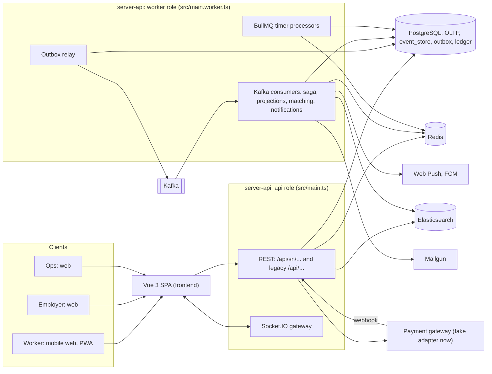
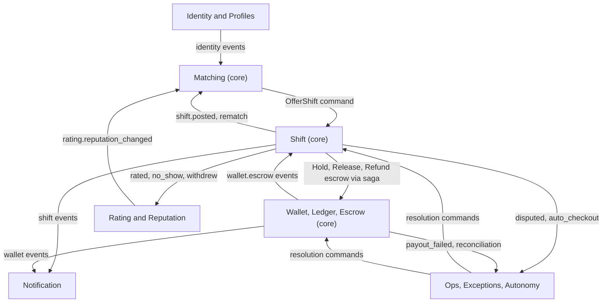
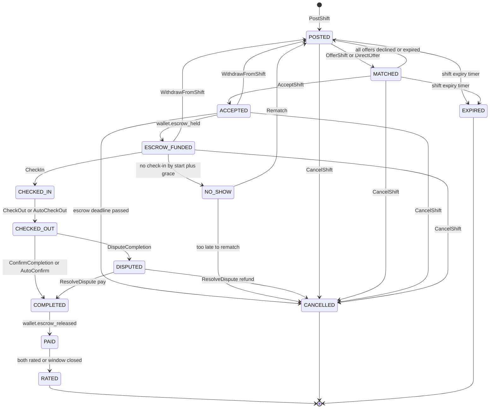
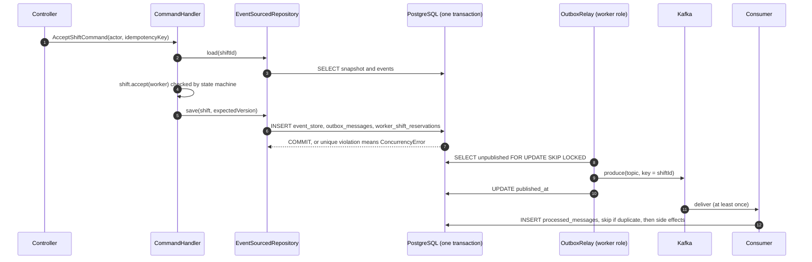

# Shift Network (flexiwork) — Architecture

| | |
|---|---|
| Status | Proposed, approved for implementation via [PLAN.md](PLAN.md) |
| Date | 2026-10-10 |
| Scope | `server-api/` (NestJS) and `frontend/` (Vue) |
| Audience | Engineers and AI agents implementing the plan; reviewers |

**Legend used throughout**

- ✅ **Verified**: read in the repo; the path is given.
- 🆕 **Proposed**: does not exist yet; the implementation creates it.
- ⚠️ **Assumption / default**: needs confirmation; see *Open questions* in [PLAN.md](PLAN.md#appendix-b--open-questions).

---

## Table of contents

1. [Product summary](#1-product-summary)
2. [Current state (as read)](#2-current-state-as-read)
3. [Target architecture overview](#3-target-architecture-overview)
4. [Bounded contexts and context map](#4-bounded-contexts-and-context-map)
5. [Shift lifecycle](#5-shift-lifecycle)
6. [Event-driven design](#6-event-driven-design)
7. [CQRS and event sourcing](#7-cqrs-and-event-sourcing)
8. [Wallet, ledger and escrow](#8-wallet-ledger-and-escrow)
9. [Matching and search (Elasticsearch)](#9-matching-and-search-elasticsearch)
10. [Attendance (check-in / check-out)](#10-attendance-check-in--check-out)
11. [Notifications and push](#11-notifications-and-push)
12. [Redis usage map](#12-redis-usage-map)
13. [Ready for AI agents (nothing built now)](#13-ready-for-ai-agents-nothing-built-now)
14. [SOLID and design patterns: where each one lives](#14-solid-and-design-patterns-where-each-one-lives)
15. [DDD and Clean Architecture: where they help](#15-ddd-and-clean-architecture-where-they-help)
16. [Backend conventions for new code](#16-backend-conventions-for-new-code)
17. [Frontend architecture](#17-frontend-architecture)
18. [Cross-cutting concerns](#18-cross-cutting-concerns)
19. [Deployment topology](#19-deployment-topology)
20. [Architecture decision log](#20-architecture-decision-log)

---

## 1. Product summary

Shift Network connects **casual/short-term workers** (*người lao động*) with **employers** (*doanh nghiệp*) by location, for same-day or short-term shifts in Vietnam. **Each shift is one transaction** with a lifecycle:

`posted → matched → accepted → escrow funded → checked in → checked out → completed → paid → rated`

It also has failure branches: expired, cancelled, no-show, declined, disputed. The money side is a light ERP: wallets, a double-entry ledger and escrow, all in **VND**.

The long-term goal is that **AI agents run the normal flow and humans handle only exceptions**. No agent is built now. The architecture only makes that possible later (section 13).

---

## 2. Current state (as read)

### 2.1 What the repository actually is

The repository is **Flexiwork**, a Swiss architecture-firm ERP. It contains no shift, worker, wallet, ledger, escrow, matching or geo-location code.

| Fact | Evidence |
|---|---|
| ✅ Backend package `flexiwork_api` v0.0.11, "Server API for Flexiwork" | `server-api/package.json` |
| ✅ Frontend package `flexiwork` v0.0.10 | `frontend/package.json` |
| ✅ Domain: offers, projects, invoices (Swiss QR bill), expenses, products/VAT, tasks, timesheets, reports, exports (docx/pdf/xlsx) | `server-api/src/modules/*`, `@bbitgmbh/bbit.swiss-qr-bill` dependency |
| ✅ Currency enum `CHF`, `USD`; languages `de`, `en` | `server-api/src/shared/enums/currency.enum.ts`, `language.enum.ts` |
| ✅ Root folder is not a git repository; no CI, Dockerfile or docker-compose | repo root listing |

**Decision (user):** treat the legacy code as a **code-convention reference**. Reuse the tables and logic that fit (§2.5). Everything else **stays in place, untouched, still running, and hidden from the menu**. Nothing is renamed or deleted.

### 2.2 Backend facts

| Area | What exists | Evidence |
|---|---|---|
| Framework | NestJS 10, TypeScript 5, Express platform | `server-api/package.json` |
| Persistence | Sequelize 6 + `sequelize-typescript`, PostgreSQL (`pg`) | `src/database/database.provider.ts` |
| Model registration | One `'SEQUELIZE'` provider; models listed in an array; associations in `loadRelationships()` | `src/database/database.provider.ts` |
| Schema management | Runs `sequelize.sync()` **on every boot**; also runs `deleteInvalidData(UserActivation → User)` on every boot | `src/database/database.provider.ts` |
| Migrations | `sequelize-cli`; path is `src/database/migrations/v${package.version}` (only the current version folder runs) | `server-api/.sequelizerc`, `src/database/migrations/v0.0.8…v0.0.11/` |
| Auth | Global `JWTAuthGuard` (HS256, payload `{sub}`) registered as `APP_GUARD`; loads the user, checks `is_active`, sets `request.user` | `src/shared/guards/auth.guard.ts`, `src/modules/auth/auth.module.ts` |
| Public routes | `@PublicRoute()` decorator | `src/shared/decorators/public-route.decorator.ts` |
| Roles | `RoleEnum { ADMIN='admin', MANAGER='manager', EMPLOYEE='employee' }`; `AllowedRoleGuard([...])` mixin | `src/shared/enums/role.enum.ts`, `src/shared/guards/allowed-role.guard.ts` |
| Token | `AuthService.generateToken(user)` (exported by `AuthModule`) | `src/modules/auth/services/auth.service.ts` |
| Login | `POST /api/login`; one email may exist in several companies → returns a company picker | `src/modules/users/services/user.service.ts` (`login`, `findOneByEmail`) |
| Audit | `@AuditModule()` / `@AuditAction()` + global `AuditInterceptor` → `audit_logs` (before/after JSON) | `src/shared/interceptors/audit.interceptor.ts`, `src/shared/constants/audit.constants.ts` |
| Response envelope | `BaseController.sendApiResponse()` → `{ error, payload, count?, code?, language?, ... }`; `throwError()` maps `BaseError.statusCode` | `src/shared/controllers/base.controller.ts`, `src/shared/utils/api-response.ts` |
| Errors | `BaseError`, `BadRequestError`, `UnauthorizedError`, `ForbiddenError`, `NotFoundError`, `NotAcceptableError`, `InternalServerError` | `src/shared/utils/base.error.ts` |
| Query helpers | `getOrderOptions()`, `getFilterOptions()` (`field:direction`, `field:value`) | `src/shared/utils/generate-ORM-options.ts` |
| Transactions | Opened manually where needed (`Model.sequelize.transaction()`) | e.g. `src/modules/invoices/services/invoice.service.ts`, `offer.service.ts` |
| Cache | `CacheModule.register({ isGlobal: true })` (in-memory) + `CacheService` (config values, version) | `src/app.module.ts`, `src/shared/services/cache.service.ts` |
| Scheduling | `@nestjs/schedule`; one cron with hardcoded `Europe/Zurich` | `src/shared/services/cron.service.ts` |
| Mail | Mailgun `SendMailService` with HTML templates and `{{.KEY}}` placeholders | `src/shared/services/send-mail.service.ts`, `src/templates/mail-templates/` |
| Files | `POST /api/files` and `GET /api/uploads/*` are `@PublicRoute()` | `src/app.controller.ts` |
| Logging | Winston daily-rotate `FileLogger` in staging/production | `src/shared/services/file-logger.service.ts`, `src/main.ts` |
| API docs | Swagger at `/docs` | `src/main.ts` |
| Event/queue infrastructure | **None.** `queue.service.ts` is fully commented out; no Kafka, Redis, Elasticsearch, WebSocket or push dependencies | `src/shared/services/queue.service.ts`, `package.json` |
| Tests | Only `src/app.controller.spec.ts`, and it is **empty (0 bytes)** | jest config in `package.json` |

### 2.3 Backend conventions to copy

These are the conventions new code must follow (✅ observed):

- **Module layout:**
  ```
  src/modules/<name>/
    controllers/<name>.controller.ts
    dto/*.dto.ts + index.ts
    services/<name>.service.ts
    constants/*.ts + index.ts
    <name>.module.ts
    <name>.provider.ts
  ```
  Examples: `src/modules/projects/`, `src/modules/invoices/`.
- **Repository injection by string token:** `<name>.provider.ts` maps a token to the model class, e.g. `{ provide: 'PROJECT_REPOSITORY', useValue: Project }`. Services use `@Inject('PROJECT_REPOSITORY') private readonly projectRepository: typeof Project`.
- **Controller structure:**
  - `@Controller('api')`, `@ApiTags`, `@ApiBearerAuth`, `@ApiOperation({ summary, operationId })`, `@UseGuards(AllowedRoleGuard([...]))`, `@AuditModule(...)`.
  - Handlers take `@Res() res` and `@CurrentUser() user`, wrap the call in `try { ... sendApiResponse } catch { throwError }`, and extend `BaseController`.
- **Models:** `src/database/models/<plural-kebab>.model.ts`, default export class, snake_case columns, `@ApiProperty` on columns.
- **DTOs:** class-validator + Swagger decorators.

Anti-pattern to **avoid**: very large services (`src/modules/projects/services/project.service.ts` has 4,015 lines; `dashboard.service.ts` 2,496; `invoice.service.ts` 2,304).

### 2.4 Frontend facts

| Area | What exists | Evidence |
|---|---|---|
| Build | Vue CLI 4 (`@vue/cli-service ^4.3.1`), webpack 4, `serve` uses `--openssl-legacy-provider`; dev proxy `/api → http://localhost:7001` | `frontend/package.json`, `frontend/vue.config.js` |
| Vue | `vue ^2.6.11`, resolved to **2.7.16** in `yarn.lock` but **2.6.14** in `package-lock.json`; code imports `defineComponent` from `vue` (needs 2.7) | `frontend/yarn.lock`, `frontend/package-lock.json`, `src/features/offers/pages/Offer/Offer.ts` |
| Package manager | `packageManager: yarn@4.4.1`; but `frontend/.gitignore` ignores `yarn.lock` | `frontend/package.json`, `frontend/.gitignore` |
| UI | Metronic theme (`src/assets`, `src/core/plugins/metronic.js`); **bootstrap-vue 2.23.1** (≈1,432 `<b-*>` tags in 96 files); Vuetify 2 registered but used once (`<v-img>` in `src/view/content/widgets/mixed/Widget1.vue`, rendered by the legacy dashboard) | `src/main.js`, `src/core/plugins/vuetify.js` |
| State | Vuex 3 modules | `src/core/services/store/index.js` |
| Routing | vue-router 3, hash mode (no `mode` set), all routes in one file | `src/router.js` |
| i18n | vue-i18n 8; locales `en, ch, es, jp, de, fr`; default `de` from localStorage; `de.js`/`en.js` ≈1,125 lines each; language switcher in the header | `src/core/plugins/vue-i18n.js`, `src/core/config/i18n/`, `src/core/services/i18n.service.js`, `src/view/layout/header/Topbar.vue` |
| API layer | `ApiService` (axios, prefix `/api`, Bearer token from localStorage) + endpoint builders | `src/api/api.service.ts`, `src/api/endpoints.ts` |
| Feature layout | `src/features/<f>/{components/<C>/<C>.vue,.ts,.scss; pages/<P>/<P>.vue,.ts,.scss; services/; dtos/; constants/; index.ts}`; logic in `.ts` using `defineComponent` + `setup()` | `src/features/offers/`, `projects/`, `tasks/`, `timesheet/` |
| Time | `moment.tz.setDefault("Europe/London")` globally | `src/main.js` |
| Env usage | `process.env.BASE_URL`, `process.env.VUE_APP_API_URL` | `src/core/services/i18n.service.js`, `src/features/offers/pages/OfferDetail/OfferDetail.ts` |
| Auth bootstrap | `VERIFY_AUTH` calls `GET /api/verify`, which loads the user's company; it redirects to `login` on failure | `src/core/services/store/auth.module.js`, `server-api/src/modules/users/controllers/users.controller.ts` |
| Tests | None | — |

### 2.5 Reuse vs ignore

| Asset | Decision | Why |
|---|---|---|
| `users` table + `User` model | **Reuse** for all people (worker, employer staff, ops) | Has email, password, role, phone, avatar, is_active, metadata |
| `companies` table | **Reuse** as the employer organisation (tenant) | Already the tenant key (`company_id` everywhere) |
| `JWTAuthGuard`, `AuthService.generateToken`, `@PublicRoute`, `AllowedRoleGuard`, `@CurrentUser` | **Reuse** | Works with any role; new routes are protected by default |
| `AuditInterceptor` + `@AuditModule/@AuditAction` | **Reuse**, adding new `AuditModuleEnum` values | Request-level audit stays useful alongside the event store |
| `BaseController`, `ApiResponse`, `BaseError` family, `getOrderOptions/getFilterOptions` | **Reuse** | Keeps one response contract for the frontend |
| `SendMailService` | **Reuse** as the email channel; add Vietnamese templates | Already uses Mailgun |
| Migrations tooling (`.sequelizerc`, `migrate:*` scripts) | **Reuse** (bump the version) | Existing workflow |
| `libphonenumber-js`, `@node-rs/bcrypt` (already dependencies) | **Reuse** for +84 phones and password hashing | `server-api/package.json`, `user.service.ts` |
| `POST /api/login`, `GET /api/verify` | **Not used by new frontend screens** | `/verify` loads a company, but workers have none; the legacy login's multi-company flow doesn't fit workers |
| Offers, projects, invoices, products/VAT, expenses, tasks, work-items/timesheets, exports, dashboard, reports | **Ignore** (keep running, hidden) | Different domain; CHF/Swiss-specific |
| `CronService` (`@nestjs/schedule`) | **Leave as is**; new timers use BullMQ | Cron would run on every instance |

---

## 3. Target architecture overview

### 3.1 Principles

1. **Modular monolith first.** One NestJS codebase, one database. Bounded contexts talk only through **events** and small **ports**, so any context can be split out later.
2. **PostgreSQL is the source of truth.** Kafka transports events, Elasticsearch is a derived read model, and Redis holds ephemeral or coordination state. Losing Kafka, ES or Redis data must never lose business facts.
3. **Every write is a command with an actor; every state change is an event.** This is what lets AI agents plug in later (§13).
4. **Additive only.** New modules, tables, topics and routes. Existing behaviour stays the same; the few allowed edits are listed in [PLAN.md §0.2](PLAN.md#02-allowed-edits-to-existing-files).

### 3.2 Container view



### 3.3 Process roles (same code, two entry points)

| Role | Entry point | Runs | Scales by |
|---|---|---|---|
| `api` | ✅ `src/main.ts` (unchanged) | HTTP controllers (legacy + `/api/sn/*`), Socket.IO gateway, command handlers | Requests/second |
| `worker` | 🆕 `src/main.worker.ts` + 🆕 `src/worker.module.ts` (`NestFactory.createApplicationContext`) | Outbox relay, Kafka consumers (saga, projections, matching, notifications, reputation), BullMQ processors, reconciliation | Kafka partitions and timer volume |

With `MESSAGE_BUS_DRIVER=memory` (dev/tests), the `api` process also runs the relay and consumers in-process, so one process is enough for local work.

---

## 4. Bounded contexts and context map

| Context | Module path 🆕 | Kind | Internal style | Owns (tables) | Publishes | Consumes |
|---|---|---|---|---|---|---|
| Identity & Access | ✅ `src/modules/auth`, `users` (reused) + 🆕 `src/modules/sn-auth` | Generic | Flat (existing convention) | `users`, `companies` (reused) | `identity.*` | — |
| Worker Profile | `src/modules/worker-profile` | Supporting | Flat | `worker_profiles`, `skills` | `identity.worker_*` | `rating.reputation_changed` |
| Employer Profile | `src/modules/employer-profile` | Supporting | Flat | `employer_profiles`, `work_locations` | `identity.employer_*`, `identity.work_location_*` | — |
| **Shift** (incl. attendance) | `src/modules/shift` | **Core** | **Layered (DDD)** | `event_store` (stream `shift`), `shift_views`, `worker_shift_reservations` | `shift.*` | `wallet.*`, timers |
| **Wallet / Ledger / Escrow** | `src/modules/wallet` | **Core** | **Layered (DDD)** | `ledger_*`, `payment_intents` | `wallet.*` | wallet commands from the shift saga |
| **Matching** | `src/modules/matching` | **Core** | **Layered (DDD)** | ES `workers`, `shifts` indexes (derived) | (sends `OfferShift` commands) | `shift.*`, `identity.*`, `rating.*` |
| Rating & Reputation | `src/modules/rating` | Supporting | Flat | `ratings` | `rating.reputation_changed` | `shift.*` |
| Notification | `src/modules/notification` | Generic | Flat + channel adapters | `notifications`, `notification_deliveries`, `push_subscriptions`, `notification_preferences` | — | all `*.events` |
| Ops / Exceptions / Autonomy | `src/modules/ops` + `src/shared/autonomy` | Supporting | Flat | `exception_cases`, `autonomy_policies`, `decision_records` | `exception.*`, `decision.recorded` | all `*.events`, DLQ |

All new modules are wired through a single aggregator, 🆕 `src/modules/shift-network/shift-network.module.ts`. `AppModule` imports it only when `FEATURE_SHIFT_NETWORK=true`.



---

## 5. Shift lifecycle

### 5.1 Aggregate and granularity

- **One `Shift` = one worker slot = one transaction** (⚠️ Q1). An employer job post with headcount *N* creates *N* shifts that share a `job_ref` (UUID). Each shift is its own event stream (`stream_type='shift'`, `stream_id=<shift uuid>`).
- Main fields of the aggregate:
  - identity and ownership: `id`, `job_ref`, `company_id`, `work_location_id`;
  - the job: `title`, `skill_code`, `time_range {start_at, end_at}`, `pay_rate {hourly_vnd, multipliers}`, `dispatch_mode`;
  - who is involved: `offered_worker_ids[]`, `worker_id`;
  - money and attendance: `escrow {amount_vnd, status}`, `attendance {checked_in_at, checked_out_at, worked_minutes, geo}`, `approved_minutes`, `ratings {employer, worker}`;
  - lifecycle: `status`, `version`.

### 5.2 States

| State | Meaning |
|---|---|
| `POSTED` | Published; matching may run |
| `MATCHED` | Offer(s) sent to candidate worker(s); waiting for acceptance |
| `ACCEPTED` | A worker accepted; reservation created; escrow requested |
| `ESCROW_FUNDED` | The full estimated cost is held in `escrow:shift:{id}` |
| `CHECKED_IN` | The worker checked in (geofence/time/QR validated) |
| `CHECKED_OUT` | The worker checked out; employer confirmation/dispute window open (🆕 state added to the user's list for this window) |
| `COMPLETED` | Hours approved (by the employer or automatically) |
| `PAID` | Escrow released to the worker wallet (net of PIT) and fee taken |
| `RATED` | Terminal: both sides rated, or the rating window closed |
| `NO_SHOW` | Transitional: no check-in by start + grace |
| `DISPUTED` | Employer disputed the completion; sits in the ops exception queue |
| `CANCELLED` | Terminal: by employer, worker-side rules or the system (reason recorded) |
| `EXPIRED` | Terminal: nobody accepted before `start_at − min_lead` |

### 5.3 State diagram



### 5.4 Transition table

The table is implemented as a single constant in 🆕 `src/modules/shift/domain/shift-state-machine.ts` (State pattern, table-driven). Any `(state, command)` pair not listed is rejected with `ShiftTransitionError` (HTTP 409).

| From | Command | Actor(s) | Guard | To | Event(s) |
|---|---|---|---|---|---|
| — | `PostShift` | employer (admin/manager) | start in future ≥ min lead; location belongs to company; rate ≥ policy minimum | `POSTED` | `shift.posted` |
| `POSTED` | `OfferShift` | system (matching) | candidates eligible | `MATCHED` | `shift.offered` |
| `POSTED` | `DirectOffer` | employer | worker eligible (rehire a favourite) | `MATCHED` | `shift.offered` (`mode=direct`) |
| `MATCHED` | `DeclineOffer` | worker | worker is in the offer list | `MATCHED` / `POSTED` if no offers left | `shift.offer_declined` |
| `MATCHED` | `ExpireOffer` | system (timer) | offer still pending | `POSTED` | `shift.offer_expired` |
| `MATCHED` | `AcceptShift` | worker | offered; not expired; no overlapping reservation | `ACCEPTED` | `shift.accepted` |
| `ACCEPTED` | `RecordEscrowFunded` | system (saga) | `wallet.escrow_held` for this shift | `ESCROW_FUNDED` | `shift.escrow_funded` |
| `ACCEPTED` | `FailEscrowFunding` | system (timer) | deadline passed | `CANCELLED` | `shift.cancelled{reason:escrow_funding_failed}` |
| `ACCEPTED`, `ESCROW_FUNDED` | `WithdrawFromShift` | worker | before check-in | `POSTED` | `shift.worker_withdrew`, `shift.rematch_requested` |
| `ESCROW_FUNDED` | `CheckIn` | worker | check-in chain passes (§10) | `CHECKED_IN` | `shift.worker_checked_in` |
| `ESCROW_FUNDED` | `RecordNoShow` | system (timer) | no check-in by start + grace | `NO_SHOW` | `shift.no_show_recorded` |
| `NO_SHOW` | `Rematch` | system (policy) | enough time before end | `POSTED` | `shift.rematch_requested` |
| `NO_SHOW` | `CancelShift` | system (policy) | too late to rematch | `CANCELLED` | `shift.cancelled{reason:no_show}` |
| `CHECKED_IN` | `CheckOut` | worker | within geofence (lenient) | `CHECKED_OUT` | `shift.worker_checked_out` |
| `CHECKED_IN` | `AutoCheckOut` | system (timer) | end + N min passed | `CHECKED_OUT` | `shift.worker_checked_out{auto:true}` + exception case |
| `CHECKED_OUT` | `ConfirmCompletion` | employer | approved minutes ≤ worked minutes + tolerance | `COMPLETED` | `shift.completed` |
| `CHECKED_OUT` | `AutoConfirmCompletion` | system (timer/policy) | window passed, no dispute | `COMPLETED` | `shift.completed{auto:true}` |
| `CHECKED_OUT` | `DisputeCompletion` | employer | inside the window | `DISPUTED` | `shift.disputed` |
| `DISPUTED` | `ResolveDispute` | ops (agent later) | resolution valid | `COMPLETED` or `CANCELLED` | `shift.dispute_resolved` + `shift.completed` or `shift.cancelled` |
| `COMPLETED` | `RecordPaymentReleased` | system (saga) | `wallet.escrow_released` | `PAID` | `shift.paid` |
| `PAID` | `RateShift` | employer or worker | participant; not rated yet | `PAID` or `RATED` (second rating) | `shift.rated` (+ `shift.ratings_closed`) |
| `PAID` | `CloseRatingWindow` | system (timer) | window passed | `RATED` | `shift.ratings_closed` |
| `POSTED`, `MATCHED` | `ExpireShift` | system (timer) | `start_at − min_lead` reached | `EXPIRED` | `shift.expired` |
| `POSTED`…`ESCROW_FUNDED` | `CancelShift` | employer | — (fee per cancellation policy) | `CANCELLED` | `shift.cancelled{reason:employer}` |

### 5.5 Timers

Timers are BullMQ delayed jobs (🆕 `src/shared/timers/`). The job id is `${shiftId}:${timer}:${streamVersion}`, so scheduling is idempotent. **Every handler reloads the aggregate and acts only if the state still matches**, so a late timer does nothing.

| Timer | Scheduled on | Fires at (default ⚠️ Q7) | Command |
|---|---|---|---|
| `offer_expiry` | `shift.offered` | offered + `SN_OFFER_TTL_MIN` (15) | `ExpireOffer` |
| `shift_expiry` | `shift.posted`, `shift.rematch_requested` | `start_at − SN_SHIFT_MIN_LEAD_MIN` (60) | `ExpireShift` |
| `escrow_deadline` | `shift.accepted` | min(accepted + `SN_ESCROW_DEADLINE_MIN` (30), start − 30) | `FailEscrowFunding` |
| `check_in_reminder` | `shift.escrow_funded` | start − 60 min | notification only |
| `no_show` | `shift.escrow_funded` | start + `SN_NO_SHOW_GRACE_MIN` (15) | `RecordNoShow` |
| `auto_checkout` | `shift.worker_checked_in` | end + `SN_AUTO_CHECKOUT_AFTER_END_MIN` (120) | `AutoCheckOut` |
| `auto_confirm` | `shift.worker_checked_out` | checked out + `SN_AUTO_CONFIRM_HOURS` (12 h) | `AutoConfirmCompletion` |
| `rating_window` | `shift.paid` | paid + `SN_RATING_WINDOW_HOURS` (72 h) | `CloseRatingWindow` |

In development, `SN_TIMER_SPEEDUP` (e.g. `60`) divides every duration, so failure branches can be tested in seconds. It is ignored unless `NODE_ENV=development`.

### 5.6 Policies on the failure branches (defaults ⚠️ Q7)

| Situation | Default policy (config-driven, Strategy) |
|---|---|
| Employer cancels ≥ `SN_FREE_CANCEL_HOURS` (12 h) before start | Full refund of escrow incl. fee |
| Employer cancels later, worker already accepted | `SN_LATE_CANCEL_COMP_PCT` (30 %) of the estimated gross to the worker; rest refunded; no platform fee |
| Worker withdraws | Back to `POSTED`; escrow **stays held for the shift** (escrow belongs to the shift, not the worker); reliability −10; ≥ 3 late withdrawals in 30 days → exception case |
| No-show | Reliability −20; rematch if `end_at − now ≥ 50 %` of the duration, else cancel + full refund; repeated no-shows → exception case |
| Auto checkout | Uses `end_at` as checkout time, flags for employer review, low-severity exception case |
| Dispute | Funds stay in escrow; exception case; ops resolves with approved minutes (partial pay) or a refund |
| No candidate found by expiry | `EXPIRED`; exception case of type *matching_exhausted* with suggested actions (raise pay, widen radius) |

### 5.7 Pricing

- 🆕 `src/modules/shift/domain/policies/pricing.policy.ts` (Strategy chain).
- `estimated_gross = Σ minutes × hourly_vnd × multiplier(segment)`, where segments are split at 22:00 and 06:00 and by day type.
- Default multipliers follow the minimums in the Vietnam Labour Code 2019 (⚠️ verify with counsel; all configurable):
  - night work: +30 %;
  - weekly rest day: 200 %;
  - public holiday: 300 %.
- Overtime does not apply to a single short shift by default.
- `platform_fee = round(estimated_gross × SN_PLATFORM_FEE_PCT)`, charged on the employer side (⚠️ Q5).
- Escrow hold = `estimated_gross + platform_fee`.
- All amounts are integer VND, rounded half-up to 1,000 VND for display only. Stored values are exact integers.

---

## 6. Event-driven design

### 6.1 Two kinds of events

| | Domain events | Integration events |
|---|---|---|
| Purpose | State changes inside an aggregate (rebuild state) | Facts other contexts react to |
| Transport | In-process (`@nestjs/cqrs` `EventBus`) after commit | Kafka via the transactional outbox |
| Schema owner | The aggregate (🆕 `src/modules/<ctx>/domain/events/`) | Shared contract (🆕 `src/shared/contracts/events/<ctx>.events.ts`) |
| Stability | Can change with upcasters | Versioned; consumers may lag |

In this design the Shift **domain events are published as integration events with the same type and payload**. One schema keeps things simple. Fields private to a context (if any) are stripped by a mapper before the outbox write.

### 6.2 Envelope

🆕 `src/shared/events/event-envelope.ts`

```ts
export interface EventEnvelope<P = unknown> {
  event_id: string;            // crypto.randomUUID()
  type: string;                // 'shift.accepted'
  version: number;             // payload schema version, starts at 1
  stream_type: 'shift' | 'wallet' | 'identity' | 'rating' | 'exception' | 'decision';
  stream_id: string;           // aggregate id (uuid) or account id
  stream_version: number | null; // set for event-sourced streams
  occurred_at: string;         // ISO-8601 UTC
  company_id: number | null;   // tenant (employer), null for worker-only facts
  actor: { type: 'user' | 'system' | 'agent'; id: string; role?: string; on_behalf_of?: string };
  correlation_id: string;      // one per business flow (shift id for shift flows)
  causation_id: string | null; // event_id or command id that caused this
  idempotency_key?: string;    // from the Idempotency-Key header, if any
  payload: P;
}
```

### 6.3 Naming and versioning

- Type = `<context>.<past_tense_snake>`, e.g. `shift.worker_checked_in`, `wallet.escrow_released`.
- **Additive** payload changes keep `version`. **Breaking** changes bump `version` and register an upcaster (🆕 `src/shared/events/upcaster.ts`) so old events in the store still load.
- The topic name has `.v1`; it changes only if the envelope itself changes incompatibly.

### 6.4 Kafka topics

| Topic | Key (ordering) | Producers | Consumer groups | Partitions dev/prod | Retention |
|---|---|---|---|---|---|
| `sn.shift.events.v1` | `shift_id` | Shift | `sn-saga-shift`, `sn-proj-shift-view`, `sn-proj-es-shifts`, `sn-matching`, `sn-reputation`, `sn-notification`, `sn-ops` | 3 / 12 | 30 days (the event store is the real archive) |
| `sn.wallet.events.v1` | `shift_id` if present, else `account_id` | Wallet | `sn-saga-shift`, `sn-notification`, `sn-ops` | 3 / 12 | 30 days |
| `sn.identity.events.v1` | `user_id` / `company_id` | Profiles, sn-auth | `sn-proj-es-workers`, `sn-notification` | 3 / 6 | 30 days |
| `sn.rating.events.v1` | `user_id` | Rating | `sn-proj-es-workers`, `sn-matching` | 3 / 6 | 30 days |
| `sn.exception.events.v1` | `case_id` | Ops | `sn-notification` | 1 / 3 | 30 days |
| `sn.decision.events.v1` | `subject_id` | Autonomy | `sn-ops` | 1 / 3 | 90 days |
| `sn.dlq.v1` | original key | any consumer | `sn-ops-dlq` | 1 / 3 | 14 days |

Client: `kafkajs`, wrapped in the 🆕 `MessageBroker` port (`src/shared/messaging/message-broker.port.ts`), so switching to `@confluentinc/kafka-javascript` only touches the adapter. Production replication factor: 3.

### 6.5 Delivery: transactional outbox and idempotent inbox



- **Outbox** (`outbox_messages`) is written in the **same transaction** as the state change, so there are no lost or phantom events. The relay polls every 200 ms in batches of 200 (configurable), and several relay instances are safe thanks to `SKIP LOCKED`. Debezium CDC can replace polling later without changing producers.
- **Inbox** (`processed_messages`, PK `(consumer_group, event_id)`): each consumer inserts the row in the same transaction as its side effect. A duplicate insert means "already done": acknowledge and skip.
- **Ordering:** guaranteed per key (shift, account). Consumers must not assume order across keys.
- **Retries:** 5 in-process attempts with exponential backoff (1 s → 16 s). After that the message goes to `sn.dlq.v1` with headers `x-original-topic`, `x-consumer-group`, `x-error`, `x-attempts`, and an exception case of type `dlq_message` is opened. Ops can replay it (`POST /api/sn/ops/dlq/:id/replay`).
- **In-memory driver** (`MESSAGE_BUS_DRIVER=memory`): the relay hands outbox rows to in-process subscribers right after commit. Same contracts, used for unit tests and Kafka-free dev.

### 6.6 Event catalog (v1)

| Type | Stream | Payload essentials |
|---|---|---|
| `shift.posted` | shift | job_ref, company_id, work_location_id, title, skill_code, start_at, end_at, hourly_vnd, estimated_gross_vnd, platform_fee_vnd, dispatch_mode, geo{lat,lng}, province, ward |
| `shift.offered` | shift | worker_ids[], mode (sequential/broadcast/direct), expires_at, ranking_snapshot[] |
| `shift.offer_declined` / `shift.offer_expired` | shift | worker_id |
| `shift.accepted` | shift | worker_id, escrow_amount_vnd |
| `shift.escrow_funded` | shift | journal_id, amount_vnd |
| `shift.worker_checked_in` | shift | at, lat, lng, accuracy_m, late_minutes, method (gps/qr) |
| `shift.no_show_recorded` | shift | worker_id |
| `shift.worker_withdrew` | shift | worker_id, hours_before_start |
| `shift.rematch_requested` | shift | reason |
| `shift.worker_checked_out` | shift | at, worked_minutes, auto |
| `shift.disputed` | shift | reason_code, note, claimed_minutes |
| `shift.dispute_resolved` | shift | outcome (pay/partial/refund), approved_minutes, resolver |
| `shift.completed` | shift | approved_minutes, gross_vnd, fee_vnd, auto |
| `shift.paid` | shift | journal_id, gross_vnd, pit_vnd, net_vnd, fee_vnd, refund_vnd |
| `shift.rated` | shift | rater_role, rater_id, ratee_id, stars, tags[], comment |
| `shift.ratings_closed` | shift | employer_rated, worker_rated |
| `shift.cancelled` | shift | reason, by, compensation_vnd, refund_vnd |
| `shift.expired` | shift | — |
| `wallet.topup_succeeded` / `wallet.topup_failed` | wallet | intent_id, account_id, amount_vnd, provider_ref |
| `wallet.escrow_held` / `wallet.escrow_hold_failed` | wallet | shift_id, journal_id, amount_vnd, reason |
| `wallet.escrow_released` / `wallet.escrow_refunded` | wallet | shift_id, journal_id, splits{worker, pit, fee, refund, compensation} |
| `wallet.payout_requested` / `wallet.payout_settled` / `wallet.payout_failed` | wallet | intent_id, worker_id, amount_vnd, provider_ref, error |
| `identity.worker_registered` / `identity.worker_profile_updated` | identity | user_id, skills, home geo, radius_km, verified |
| `identity.employer_registered` / `identity.work_location_created` / `identity.work_location_updated` | identity | company_id, location fields |
| `rating.reputation_changed` | rating | user_id, rating_avg, rating_count, reliability_score |
| `exception.case_opened` / `exception.case_resolved` | exception | case_id, type, severity, subject |
| `decision.recorded` | decision | decision_point, subject, outcome, confidence, rationale, inputs_hash, provider |

---

## 7. CQRS and event sourcing

### 7.1 Where each technique is used

| Aggregate / data | Write model | Why |
|---|---|---|
| **Shift** | **Event-sourced** (`event_store`) | Long lifecycle with many branches; the full history is needed for disputes, audit and agent context ("timeline"); state is rebuilt by replay |
| **Money** | **Journal-sourced**: an append-only, balanced double-entry ledger (§8) | Accountants and reconciliation need double entry; the journal *is* the immutable event log of money, so a second event store would only duplicate it |
| Profiles, work locations, ratings, notifications, exception cases | CRUD (Sequelize) + an outbox event in the same transaction | Simple data; event sourcing would add cost with no benefit |

### 7.2 Write side

- 🆕 `src/shared/event-store/aggregate-root.ts`: `apply(event)`, `when(event)`, `uncommittedEvents`, `version`.
- 🆕 `src/shared/event-store/event-sourced.repository.ts`:
  - `load(id)` reads the latest snapshot, then the events after it;
  - `save(aggregate, expectedVersion, extraWrites?)` appends the events, inserts outbox rows and runs `extraWrites` (inline projections such as `worker_shift_reservations`), all in one transaction through 🆕 `UnitOfWork` (wraps the existing `'SEQUELIZE'` provider's `sequelize.transaction()`).
- **Optimistic concurrency:** `UNIQUE (stream_id, stream_version)`. A violation becomes `ConcurrencyError`; the handler retries up to 3 times (reload + re-validate), then returns HTTP 409.
- Command handlers live in 🆕 `src/modules/<ctx>/application/commands/` with **one handler per use case** (SRP).

### 7.3 Storage schema (proposed, migration `v0.1.0`)

```sql
CREATE TABLE IF NOT EXISTS event_store (
  global_position BIGSERIAL PRIMARY KEY,
  event_id        UUID        NOT NULL UNIQUE,
  stream_type     TEXT        NOT NULL,
  stream_id       UUID        NOT NULL,
  stream_version  INTEGER     NOT NULL,
  event_type      TEXT        NOT NULL,
  event_version   SMALLINT    NOT NULL DEFAULT 1,
  payload         JSONB       NOT NULL,
  metadata        JSONB       NOT NULL,   -- actor, correlation_id, causation_id, company_id, idempotency_key
  occurred_at     TIMESTAMPTZ NOT NULL DEFAULT now(),
  UNIQUE (stream_id, stream_version)
);
CREATE INDEX IF NOT EXISTS ix_event_store_type ON event_store (stream_type, global_position);

CREATE TABLE IF NOT EXISTS aggregate_snapshots (
  stream_id UUID PRIMARY KEY, stream_type TEXT NOT NULL, stream_version INTEGER NOT NULL,
  state JSONB NOT NULL, created_at TIMESTAMPTZ NOT NULL DEFAULT now()
);

CREATE TABLE IF NOT EXISTS outbox_messages (
  id BIGSERIAL PRIMARY KEY, event_id UUID NOT NULL UNIQUE, topic TEXT NOT NULL,
  partition_key TEXT NOT NULL, headers JSONB NOT NULL DEFAULT '{}', payload JSONB NOT NULL,
  created_at TIMESTAMPTZ NOT NULL DEFAULT now(), published_at TIMESTAMPTZ NULL,
  attempts INTEGER NOT NULL DEFAULT 0, last_error TEXT NULL
);
CREATE INDEX IF NOT EXISTS ix_outbox_unpublished ON outbox_messages (id) WHERE published_at IS NULL;

CREATE TABLE IF NOT EXISTS processed_messages (
  consumer_group TEXT NOT NULL, event_id UUID NOT NULL,
  processed_at TIMESTAMPTZ NOT NULL DEFAULT now(),
  PRIMARY KEY (consumer_group, event_id)
);

CREATE TABLE IF NOT EXISTS projection_checkpoints (
  projection_name TEXT PRIMARY KEY, last_global_position BIGINT NOT NULL DEFAULT 0,
  updated_at TIMESTAMPTZ NOT NULL DEFAULT now()
);
```

Snapshots are written every 50 events per stream. Shift streams are short (≈10–20 events), so in practice snapshots matter only for replays and tooling.

### 7.4 Read side (projections)

| Projection | Store | Fed by | Consistency |
|---|---|---|---|
| `worker_shift_reservations` (double-booking guard, §9.6) | Postgres | `save(..., extraWrites)` | **Same transaction** (strong) |
| `ledger_balances` | Postgres | Ledger posting | **Same transaction** (strong) |
| `shift_views` (lists, detail, filters) | Postgres | `sn-proj-shift-view` consumer | Eventual (sub-second typical) |
| `shifts` index (nearby search) | Elasticsearch | `sn-proj-es-shifts` | Eventual |
| `workers` index (matching) | Elasticsearch | `sn-proj-es-workers` | Eventual |
| Reputation (`worker_profiles.rating_avg`, `reliability_score`) | Postgres | `sn-reputation` | Eventual |

- **Read-your-writes:** command responses return the aggregate's new state and `version`, so the UI never waits for a projection after its own command.
- **Rebuild:** 🆕 `yarn sn:rebuild-projection <name>` replays `event_store` by `global_position` into a fresh table or index (`*_v2`), then swaps (rename for tables, alias swap for ES) and resets `projection_checkpoints`.
- **Queries** (🆕 `application/queries/`) read only from projections, never from `event_store`. The one exception is `GET /api/sn/shifts/:id/timeline`, which reads the stream itself on purpose.

---

## 8. Wallet, ledger and escrow

### 8.1 Principles

- **Money is an integer number of VND** (`BIGINT`, column suffix `_vnd`). No floats, no `DECIMAL` arithmetic in JavaScript. The 🆕 `Money` value object (`src/shared/domain/money.ts`) wraps a safe integer and rejects non-integers and unsafe values.
- **Double entry:** every journal has ≥ 2 postings whose signed amounts **sum to zero**.
- **Append-only:** journals and entries are never updated or deleted. Corrections are reversal journals.
- **Idempotent:** every journal has a unique `idempotency_key` (e.g. `escrow_hold:{shiftId}`), so a duplicate command returns the existing journal.
- **Balances** (`ledger_balances`) are updated in the **same transaction** as the entries, with `SELECT … FOR UPDATE`. Rows are locked in ascending `account_id` order to avoid deadlocks, and a `CHECK` enforces non-negative balances on wallet and escrow accounts.
- **Regulatory note ⚠️:** holding user funds in Vietnam requires a State Bank of Vietnam–licensed intermediary. The internal ledger records **obligations**. Real money custody must sit with a licensed partner (bank escrow or e-wallet), connected through the `PaymentGateway` port.

### 8.2 Accounts

Sign convention: a positive posting increases the account balance. `gateway_clearing` mirrors money held at the provider/bank, so its balance is normally **negative**, and the sum of all balances is always 0.

| Account code | Type | Owner | Balance rule |
|---|---|---|---|
| `employer:{company_id}` | `employer_wallet` | company | ≥ 0 |
| `worker:{user_id}` | `worker_wallet` | worker | ≥ 0 |
| `escrow:shift:{shift_id}` | `escrow` | shift | ≥ 0; must be 0 when the shift is terminal |
| `payout_pending:{user_id}` | `payout_pending` | worker | ≥ 0 |
| `platform:fee_revenue` | `platform_revenue` | platform | ≥ 0 |
| `platform:pit_payable` | `tax_payable` | platform | ≥ 0 |
| `gateway:{provider}:clearing` | `gateway_clearing` | platform | any sign |

### 8.3 Schema (proposed)

```sql
CREATE TABLE IF NOT EXISTS ledger_accounts (
  id UUID PRIMARY KEY, code TEXT NOT NULL UNIQUE, account_type TEXT NOT NULL,
  owner_type TEXT NULL, owner_id TEXT NULL, currency CHAR(3) NOT NULL DEFAULT 'VND',
  created_at TIMESTAMPTZ NOT NULL DEFAULT now()
);
CREATE TABLE IF NOT EXISTS ledger_journals (
  id UUID PRIMARY KEY, journal_type TEXT NOT NULL, idempotency_key TEXT NOT NULL UNIQUE,
  reference_type TEXT NULL, reference_id TEXT NULL, metadata JSONB NOT NULL DEFAULT '{}',
  created_at TIMESTAMPTZ NOT NULL DEFAULT now()
);
CREATE TABLE IF NOT EXISTS ledger_entries (
  id BIGSERIAL PRIMARY KEY, journal_id UUID NOT NULL REFERENCES ledger_journals(id),
  account_id UUID NOT NULL REFERENCES ledger_accounts(id),
  amount_vnd BIGINT NOT NULL CHECK (amount_vnd <> 0),
  created_at TIMESTAMPTZ NOT NULL DEFAULT now()
);
CREATE TABLE IF NOT EXISTS ledger_balances (
  account_id UUID PRIMARY KEY REFERENCES ledger_accounts(id), account_type TEXT NOT NULL,
  balance_vnd BIGINT NOT NULL DEFAULT 0, version INTEGER NOT NULL DEFAULT 0,
  updated_at TIMESTAMPTZ NOT NULL DEFAULT now(),
  CHECK (account_type = 'gateway_clearing' OR balance_vnd >= 0)
);
CREATE TABLE IF NOT EXISTS payment_intents (
  id UUID PRIMARY KEY, kind TEXT NOT NULL,            -- topup | payout
  account_id UUID NOT NULL REFERENCES ledger_accounts(id), amount_vnd BIGINT NOT NULL CHECK (amount_vnd > 0),
  provider TEXT NOT NULL, provider_ref TEXT NULL, status TEXT NOT NULL, -- created|pending|succeeded|failed
  idempotency_key TEXT NOT NULL UNIQUE, raw_last_webhook JSONB NULL,
  created_at TIMESTAMPTZ NOT NULL DEFAULT now(), updated_at TIMESTAMPTZ NOT NULL DEFAULT now()
);
```

### 8.4 Journal templates (Factory)

🆕 `src/modules/wallet/domain/journal-templates.ts`: one factory function per journal type. Each one builds postings and asserts Σ = 0.

| Journal | Postings (signed) | Trigger |
|---|---|---|
| `TOPUP` | clearing −A; employer +A | `wallet.topup` webhook succeeded |
| `ESCROW_HOLD` | employer −H; escrow +H | saga on `shift.accepted` |
| `ESCROW_RELEASE` | escrow −H; worker +(G − PIT); pit_payable +PIT; fee_revenue +F; employer +(H − G − F) | saga on `shift.completed` |
| `ESCROW_REFUND` | escrow −H; employer +H | saga on `shift.cancelled` / `shift.expired` (when held) |
| `CANCEL_COMPENSATION` | escrow −H; worker +(C − PIT_c); pit_payable +PIT_c; employer +(H − C) | saga on a late employer cancellation |
| `PAYOUT_REQUEST` | worker −P; payout_pending +P | worker requests a payout |
| `PAYOUT_SETTLED` | payout_pending −P; clearing +P | provider webhook succeeded |
| `PAYOUT_FAILED` | payout_pending −P; worker +P | provider webhook failed |

### 8.5 Worked examples

Fee 10 %, PIT 10 % when one payment is ≥ 2,000,000 VND (⚠️ Q6). A = amount, H = hold, G = gross, F = fee, C = compensation, P = payout.

**A. 8-hour day shift at 40,000 VND/h**

- G = 320,000; F = 32,000; H = 352,000.
- `ESCROW_HOLD`: employer −352,000; escrow +352,000.
- `ESCROW_RELEASE` (8 h approved; PIT = 0 because 320,000 < 2,000,000): escrow −352,000; worker +320,000; fee +32,000. Σ = 0 ✔

**B. Partial approval: 6 h of 8 h** (G = 240,000, F = 24,000)

- escrow −352,000; worker +240,000; fee +24,000; employer +88,000 (refund of the remainder). Σ = 0 ✔

**C. 12-hour shift at 200,000 VND/h**

- G = 2,400,000; F = 240,000; H = 2,640,000; PIT = 240,000.
- escrow −2,640,000; worker +2,160,000; pit_payable +240,000; fee +240,000. Σ = 0 ✔

### 8.6 Invariants and reconciliation

- Enforced at write time:
  - Σ postings per journal = 0 (domain check plus a deferred constraint trigger 🆕);
  - non-negative balances (CHECK);
  - one `ESCROW_HOLD` per shift (unique idempotency key);
  - escrow is 0 after release, refund or compensation.
- 🆕 Daily reconciliation job (BullMQ repeatable, 02:00 Asia/Ho_Chi_Minh), checking that:
  - the sum of all `ledger_balances` = 0;
  - each balance equals Σ of its entries;
  - every escrow of a terminal shift is 0;
  - `payment_intents` succeeded/failed states match the journals.
- Any mismatch: an exception case (`ledger_mismatch`, severity *critical*) **and** the kill switch `payouts.enabled=false` (§13.7).

### 8.7 Payment gateway port (Adapter)

🆕 `src/modules/wallet/application/ports/payment-gateway.port.ts`, token `'PAYMENT_GATEWAY'`:

```ts
export interface PaymentGateway {
  readonly provider: string; // 'fake' | 'vnpay' | 'momo' | 'payos' | ...
  createTopUp(i: { intentId: string; amountVnd: number; returnUrl: string }): Promise<{ providerRef: string; redirectUrl?: string; qrPayload?: string }>;
  createPayout(i: { intentId: string; amountVnd: number; bankAccount: BankAccountRef }): Promise<{ providerRef: string }>;
  parseWebhook(headers: Record<string, string>, rawBody: Buffer): Promise<PaymentWebhookEvent>; // verifies the signature
}
```

- 🆕 `FakePaymentGateway`:
  - it posts an HMAC-signed webhook to `POST /api/sn/payments/webhooks/fake` after `FAKE_GATEWAY_DELAY_MS`;
  - amounts ending in `13` (e.g. `100013`) fail, as a deterministic test hook.
- Real providers (VNPay, MoMo, ZaloPay, PayOS/VietQR …) are later, one adapter each, with no domain changes.

---

## 9. Matching and search (Elasticsearch)

### 9.1 Flow

1. `shift.posted` (or `shift.rematch_requested`, or the last `offer_declined`/`offer_expired`) reaches the `sn-matching` consumer.
2. Candidate search goes to the ES `workers` index. The fallback is a Postgres bounding-box query if ES is unavailable.
3. Eligibility filter (Specification), then ranking (Strategy), then dispatch policy.
4. The `OfferShift` command runs on the Shift aggregate.
5. The run is idempotent per `(shift_id, stream_version)`.

### 9.2 Eligibility (Specification pattern)

🆕 `src/modules/matching/domain/eligibility/*.specification.ts`, composed with `and/or/not`:

- `IsVerifiedWorker`
- `HasSkill(skill_code)`
- `WithinRadius(shift.geo, worker.radius_km)`
- `IsAdult` (≥ 18; ⚠️ minors excluded by default)
- `NotBlockedByEmployer`
- `NoOverlappingReservation`
- `NotSuspended`
- `AvailableAt(time_range)` (if availability is set)

### 9.3 Ranking (Strategy pattern)

Token `'MATCHING_STRATEGIES'` (multi-provider). Default `WeightedScoreStrategy`:

`score = 0.35·distance_decay + 0.25·reliability + 0.20·rating + 0.10·skill_match + 0.10·worked_with_employer_before`

- Weights live in config, not code. New strategies are added by registering a provider, with no change to the core (OCP).
- The ranking inputs are stored in `shift.offered.ranking_snapshot` for explainability.

### 9.4 Dispatch policy

- `SEQUENTIAL`: offer to the top 1; on decline or expiry, the next one.
- `BROADCAST`: offer to the top K = 5; first to accept wins.
- Default: `BROADCAST` when `start_at − now < 3 h` (urgent), otherwise `SEQUENTIAL` (⚠️ configurable).

### 9.5 Index definitions (proposed, `src/shared/search/indices/*.json`)

Indexes are versioned (`sn_shifts_v1`) behind aliases (`sn_shifts`) and created by 🆕 `IndexManagerService` when the worker starts. Vietnamese search uses a **built-in folding analyzer**, so no plugin is needed:

```json
{
  "settings": {
    "analysis": {
      "filter": { "vi_fold": { "type": "asciifolding", "preserve_original": true } },
      "analyzer": { "vi_folded": { "tokenizer": "standard", "filter": ["lowercase", "vi_fold"] } }
    }
  },
  "mappings": {
    "properties": {
      "shift_id": { "type": "keyword" }, "job_ref": { "type": "keyword" }, "company_id": { "type": "long" },
      "title": { "type": "text", "analyzer": "vi_folded", "fields": { "raw": { "type": "keyword" } } },
      "skill_code": { "type": "keyword" }, "location": { "type": "geo_point" },
      "province": { "type": "keyword" }, "ward": { "type": "keyword" },
      "start_at": { "type": "date" }, "end_at": { "type": "date" },
      "hourly_vnd": { "type": "long" }, "estimated_gross_vnd": { "type": "long" },
      "status": { "type": "keyword" }, "employer_rating": { "type": "float" }
    }
  }
}
```

With this analyzer, "nha hang" matches "nhà hàng" and "đ" folds to "d". `sn_workers_v1` holds `worker_id`, `skills` (keyword[]), `home` (geo_point), `radius_km`, `reliability_score`, `rating_avg`, `verified`, `suspended`, `last_active_at`.

Only `POSTED`/`MATCHED` shifts are kept in `sn_shifts`; other statuses are deleted from the index. Worker nearby search is `GET /api/sn/shifts/nearby?lat&lng&radius_km&skill&from&to&q` (`geo_distance` filter, sorted by distance then start time).

### 9.6 No double booking (three layers)

1. **Redis lock** `lock:shift:{id}` (5 s): the fast path for broadcast races.
2. **Event-store expected version**: two concurrent accepts on one shift cannot both commit.
3. **Postgres exclusion constraint** on `worker_shift_reservations`. One worker can never hold two overlapping active shifts, even across different shift streams:
   ```sql
   CREATE EXTENSION IF NOT EXISTS btree_gist;
   CREATE TABLE IF NOT EXISTS worker_shift_reservations (
     shift_id UUID PRIMARY KEY, worker_id INTEGER NOT NULL,
     during TSTZRANGE NOT NULL, active BOOLEAN NOT NULL DEFAULT true,
     EXCLUDE USING gist (worker_id WITH =, during WITH &&) WHERE (active)
   );
   ```
   Note: `CREATE EXTENSION` may need DB-owner rights in managed Postgres (⚠️ risk R-07).

---

## 10. Attendance (check-in / check-out)

- **Check-in** is a validation chain (Chain of Responsibility, 🆕 `src/modules/shift/application/check-in/`). Each check returns a machine-readable code that the frontend translates into Vietnamese:

  | Order | Check | Default | Error code |
  |---|---|---|---|
  | 1 | State is `ESCROW_FUNDED` and the actor is the assigned worker | — | `CHECKIN_NOT_ALLOWED` |
  | 2 | Time window `start − 30 min … start + grace` | 30 / 15 min | `CHECKIN_OUTSIDE_TIME_WINDOW` |
  | 3 | GPS accuracy ≤ 100 m | 100 m | `CHECKIN_GPS_INACCURATE` |
  | 4 | Haversine distance to the work location ≤ geofence radius | 150 m | `CHECKIN_OUTSIDE_GEOFENCE` |
  | 5 | Rotating QR token (if the location requires it): `HMAC(QR_TOKEN_SECRET, shift_id + location_id + floor(now/30s))`, current or previous window | off | `CHECKIN_QR_INVALID` |

- **Check-out**: the geofence is lenient (×2 radius). It computes `worked_minutes` and flags early check-out.
- **Privacy**: only the check-in/out coordinates are stored. There is no continuous tracking. Location consent is collected at onboarding (§18.3).

---

## 11. Notifications and push

### 11.1 Pipeline

`event` → rule (🆕 `src/modules/notification/constants/notification-rules.constant.ts`) → recipients → preferences → **channel strategies** → delivery records.

| Event | Recipients | Channels | Template key (Vietnamese) |
|---|---|---|---|
| `shift.offered` | offered workers | push, in-app | `shift_offered` |
| `shift.accepted` | employer | in-app, email | `shift_accepted` |
| `wallet.escrow_hold_failed` | employer | push, in-app, email | `escrow_topup_needed` |
| `shift.escrow_funded` | worker | push, in-app | `shift_confirmed` |
| reminder timer | worker | push | `check_in_reminder` |
| `shift.no_show_recorded` | employer, worker | push, in-app | `no_show` |
| `shift.worker_checked_out` | employer | push, in-app | `confirm_completion` |
| `shift.paid` | worker | push, in-app | `payment_received` |
| `shift.cancelled` / `shift.expired` | affected parties | push, in-app | `shift_cancelled` / `shift_expired` |
| `exception.case_opened` | ops | in-app (+ email if critical) | `exception_opened` |

### 11.2 Channels (Strategy and Adapter)

🆕 `NotificationChannel` interface `{ name; supports(user, intent); send(delivery) }`, registered as a multi-provider:

| Channel | Implementation | Status |
|---|---|---|
| In-app | `notifications` table + Socket.IO gateway (namespace `/sn`, JWT on handshake, rooms `user:{id}`, `company:{id}`; Redis adapter when > 1 api instance) | v1 |
| Web Push | `web-push` (VAPID keys from env); service worker in the frontend | v1 |
| Email | reuses ✅ `SendMailService`; new templates in 🆕 `src/templates/mail-templates/vi/` (copied to `dist` by the existing `templates/**/*` asset rule in ✅ `nest-cli.json`) | v1 |
| FCM | `firebase-admin`; on only when `FCM_CREDENTIALS_PATH` is set | adapter ready, used once a mobile app exists |
| SMS / Zalo ZNS | port only (`SmsChannel`) | later ⚠️ Q4 |

- **Guarantees:** the consumer is idempotent (inbox); a delivery is unique on `(event_id, user_id, channel)`; failed deliveries retry with BullMQ backoff. Invalid push tokens are pruned (Web Push 404/410, FCM `UNREGISTERED`).
- Vietnamese copy lives in 🆕 `src/templates/notification-templates/vi.json` (`{ key: { title, body } }` with `{placeholders}`).
- iOS Safari gets web push only for installed PWAs (⚠️ risk R-12).

---

## 12. Redis usage map

| Key pattern | Purpose | TTL | Owner |
|---|---|---|---|
| `idem:{actorId}:{route}:{key}` | Idempotency-Key replay (stored status + body) | 24 h | 🆕 `src/shared/redis/idempotency.interceptor.ts` |
| `lock:shift:{id}`, `lock:worker:{id}` | Distributed locks (SET NX PX + Lua release) | 5 s | 🆕 `src/shared/redis/lock.service.ts` |
| `bull:sn-timers:*`, `bull:sn-jobs:*` | BullMQ timers, retries, reconciliation | queue-managed | 🆕 `src/shared/timers/` |
| `rl:{route}:{ip or user}` | Rate limiting on `/api/sn/auth/*` and webhooks | window | `@nestjs/throttler` Redis storage |
| `socket.io#*` | Socket.IO Redis adapter pub/sub | — | notification gateway |
| `cache:*` | Optional Redis store for the existing global `CacheModule` (`CACHE_DRIVER=redis`; default stays in-memory) | per key | `src/app.module.ts` (flagged edit) |
| `geo:workers:online` | GEOADD of workers who opted in to "available now" (later) | 15 min refresh | matching |

Redis is **never** the source of truth. If it is lost, at worst some idempotent replays become fresh executions; these are still protected by DB unique keys.

---

## 13. Ready for AI agents (nothing built now)

Goal: future agents act **through the same commands and policies as humans**, with full context and explainability, and humans see only the exceptions.

1. **Actor model:** every command and event carries `actor {type: user|system|agent, id, role, on_behalf_of?}`. Today only `user` and `system` exist. An agent will later be a service account (role `agent`), and nothing else changes.
2. **One command surface:**
   - each state change is one REST endpoint under `/api/sn/*` with a class-validator DTO, Swagger docs and a stable `operationId` (✅ the existing controllers already set `operationId`);
   - `Idempotency-Key` is required on every command POST;
   - `X-Correlation-Id` is propagated.
3. **Introspection endpoints:**
   - `GET /api/sn/shifts/:id/available-transitions` → the allowed commands for the caller's actor, with guard hints;
   - `GET /api/sn/shifts/:id/timeline` → the event stream rendered for people and machines;
   - `GET /api/sn/ops/autonomy-policies`.
4. **Decision points registry** (🆕 `src/shared/autonomy/decision-points.constant.ts`, stored in `autonomy_policies`):

   | Decision point | Default mode | Default rule | Escalates to a human when |
   |---|---|---|---|
   | `matching.dispatch` | auto | §9.3/§9.4 | no candidates |
   | `escrow.auto_hold` | auto | hold if the balance is enough | insufficient → notify the employer |
   | `no_show.handling` | auto | §5.6 | repeated no-show (≥ 2 / 30 days) |
   | `completion.auto_confirm` | auto | §5.5 | auto checkout happened |
   | `dispute.resolution` | **manual** | — | always (v1) |
   | `payout.approval` | auto | ≤ `SN_AUTO_PAYOUT_MAX_VND` (5,000,000) | above the limit or a first payout |
   | `worker.suspension` | suggest | reliability < 40 | always needs approval |

5. **`DecisionProvider` port** (🆕 `src/shared/autonomy/decision-provider.port.ts`): `decide(point, context) → { outcome, confidence, rationale, inputs }`.
   - Today: `RuleBasedDecisionProvider`. Tomorrow: `AgentDecisionProvider` (Strategy swap).
   - Below `min_confidence`, or when the mode is `suggest`/`manual`, it opens an exception case with the suggested outcome.
   - Every decision emits `decision.recorded` and stores a `decision_records` row.
6. **Exception queue** (🆕 `exception_cases`):
   - fields: `type`, `severity`, `status (OPEN → ACKNOWLEDGED → RESOLVED | DISMISSED)`, `subject_type/id`, `suggested_actions` (JSONB list of commands + params), `sla_due_at`, `resolution`;
   - resolving a case **executes normal commands** with `actor = ops user`.
7. **Guardrails:** money limits per actor type; a kill switch per decision point and the global `payouts.enabled`; rate limits; every automated money movement has an idempotency key and a reason. Agent actors (later) are limited to the `suggest` mode until a human promotes them.
8. **Explicitly out of scope now:** LLM calls, agent runtimes, prompt stores, tool servers. The ports above are the only seams.

---

## 14. SOLID and design patterns: where each one lives

### 14.1 Patterns

| Pattern | Concrete place (🆕 unless ✅) | Why here |
|---|---|---|
| **State** (table-driven) | `src/modules/shift/domain/shift-state-machine.ts` | Each transition is explicit and tested in one place |
| **Aggregate + Event Sourcing** | `src/modules/shift/domain/shift.aggregate.ts`, `src/shared/event-store/` | Full history, safe concurrency |
| **Saga / Process Manager** | `src/modules/shift/application/sagas/shift-fulfillment.saga.ts` | Coordinates Shift ↔ Wallet ↔ timers, with compensation (refund) |
| **Transactional Outbox / Idempotent Inbox** | `src/shared/messaging/outbox.service.ts`, `outbox-relay.service.ts`, `inbox.service.ts` | Exactly-once effects on top of at-least-once delivery |
| **CQRS** | `application/commands/*`, `application/queries/*` with `@nestjs/cqrs` | Write invariants vs fast reads |
| **Repository** | ✅ the existing `'<NAME>_REPOSITORY'` token providers (e.g. `src/modules/projects/project.provider.ts`) for CRUD; 🆕 `EventSourcedRepository<T>` for aggregates | Keep the convention; hide persistence from the domain |
| **Unit of Work** | `src/shared/event-store/unit-of-work.ts` | One transaction across event store, outbox and inline projections |
| **Strategy** | `MATCHING_STRATEGIES`, `PricingPolicy` rules, `NotificationChannel`, `DecisionProvider`, `CancellationPolicy` | Swap behaviour without editing the core |
| **Specification** | `src/modules/matching/domain/eligibility/` | Composable eligibility rules, reused by matching and accept-time checks |
| **Chain of Responsibility** | `src/modules/shift/application/check-in/` | Ordered, independent check-in validators |
| **Factory** | `src/modules/wallet/domain/journal-templates.ts`; `Shift.post()` | Only valid journals and shifts can be built |
| **Adapter / Ports & Adapters** | `PaymentGateway` (fake → VNPay/MoMo…), `MessageBroker` (Kafka/in-memory), `CandidateSearch` (ES/Postgres), `PushProvider` (Web Push/FCM) | Swap infrastructure; test without it |
| **Value Object** | `src/shared/domain/money.ts`, `geo-point.ts`, `time-range.ts` | Correct VND money, coordinates and time ranges |
| **Observer / Pub-Sub** | Event handlers and Kafka consumers | Decoupled reactions |
| **Decorator** | 🆕 `src/shared/decorators/idempotent.decorator.ts`, `consume-events.decorator.ts`; ✅ `@AuditModule/@AuditAction`, `@PublicRoute` | Declarative cross-cutting behaviour |
| **Mixin** | ✅ `AllowedRoleGuard()` (`src/shared/guards/allowed-role.guard.ts`) | Reused as is for role checks |
| **Template Method** | 🆕 `src/shared/messaging/base-projector.ts` (load checkpoint → handle → save checkpoint) | Same skeleton for every projection |

### 14.2 SOLID, applied

| Principle | Rule in this codebase | Where |
|---|---|---|
| **S**ingle responsibility | One command handler per use case; services stay < ~300 lines (unlike the 4,015-line `project.service.ts`) | `application/commands/*.handler.ts` |
| **O**pen/closed | New matching strategy, notification channel, pricing rule or decision provider = **new provider**, no core edit | DI multi-providers |
| **L**iskov substitution | `InMemoryMessageBroker` ≡ `KafkaMessageBroker`; `FakePaymentGateway` ≡ real gateways (same contract tests) | `src/shared/messaging`, `src/modules/wallet/infrastructure` |
| **I**nterface segregation | Small ports: `EventPublisher` vs `EventSubscriber`, `ShiftReader` vs `EventSourcedRepository`, `WorkLocationReader` | `application/ports/` |
| **D**ependency inversion | Domain and application import **only** ports. Infrastructure binds them via string tokens, like the existing `'X_REPOSITORY'` style: `'PAYMENT_GATEWAY'`, `'MESSAGE_BROKER'`, `'CANDIDATE_SEARCH'` | `<module>.provider.ts` |

---

## 15. DDD and Clean Architecture: where they help

### 15.1 Decision on `src/database` and `src/modules`

**Keep both as they are.** Nothing is moved: renames are forbidden, and the tooling depends on these paths.

- `src/database/` stays the **single persistence home**:
  - new Sequelize models go in `src/database/models/<plural-kebab>.model.ts`;
  - migrations go in `src/database/migrations/v0.1.0/`;
  - new models are registered through one new list file, 🆕 `src/database/sn-models.ts`, spread into the existing `models` array in `database.provider.ts` (a one-line edit).
- `src/modules/` gets new modules. **Only the three core contexts** use layering inside the module.

### 15.2 Core module template (Shift, Wallet, Matching)

```
src/modules/shift/
  shift.module.ts                 # Nest wiring (existing convention)
  shift.provider.ts               # token → implementation bindings (existing convention)
  domain/                         # pure TypeScript: no @nestjs/*, sequelize, kafkajs, ioredis imports
    shift.aggregate.ts
    shift-state-machine.ts
    shift-status.enum.ts
    events/*.event.ts
    policies/{pricing,cancellation,no-show}.policy.ts
    errors/*.error.ts
  application/
    commands/<verb>-shift.command.ts + .handler.ts
    queries/<name>.query.ts + .handler.ts
    sagas/shift-fulfillment.saga.ts
    check-in/*.check.ts
    ports/*.port.ts
  infrastructure/
    shift-view.projector.ts
    shift-search.projector.ts
    work-location.reader.ts       # adapter over employer-profile
  controllers/                    # existing convention name
    employer-shift.controller.ts
    worker-shift.controller.ts
  dto/                            # existing convention
  constants/
```

The **dependency rule** is enforced with an ESLint override (🆕 addition to `server-api/.eslintrc.json`):

```json
{
  "overrides": [{
    "files": ["src/modules/*/domain/**/*.ts"],
    "rules": { "no-restricted-imports": ["error", { "patterns": ["@nestjs/*", "sequelize*", "kafkajs", "ioredis", "bullmq", "@elastic/*", "src/database/*"] }] }
  }]
}
```

### 15.3 Supporting and generic contexts

`worker-profile`, `employer-profile`, `sn-auth`, `rating`, `notification` and `ops` use the **existing flat convention** (`controllers/ dto/ services/ constants/ *.module.ts *.provider.ts`). They have little domain logic, so layering would only add ceremony.

### 15.4 What we deliberately do not do

- No generic repository over every table.
- No CQRS or event sourcing for CRUD.
- No microservices in v1.
- No changes to legacy modules for "cleanliness".
- No shared kernel beyond `Money`, `GeoPoint`, `TimeRange` and the event contracts.

---

## 16. Backend conventions for new code

| Topic | Rule |
|---|---|
| Route prefix | `@Controller('api/sn')`. It avoids collisions with legacy `/api/*` routes and is covered by the existing dev proxy (`/api`) and Netlify `_redirects` (`/api/*`) |
| Controllers | Extend 🆕 `SnBaseController` (extends ✅ `BaseController`; overrides `throwError` to add a machine-readable `code` from 🆕 `CodedError extends BaseError`). Keep `operationId`, `@ApiTags('sn-…')`, `@AuditModule(AuditModuleEnum.SHIFT …)` |
| Roles | `AllowedRoleGuard([RoleEnum.WORKER])`, `[RoleEnum.ADMIN, RoleEnum.MANAGER]` (employer), `[RoleEnum.OPS]` |
| Tenancy | Employer queries are always scoped by `currentUser.company_id`; worker queries by `currentUser.id` |
| Legacy isolation | 🆕 `SnLegacyIsolationInterceptor` (global, registered by `ShiftNetworkModule`) rejects `worker`/`ops` users on any route outside `/api/sn/*`, apart from a short allowlist (`/api/logout`, `/health`). Reason: ✅ `users`, `tasks`, `work-item`, `report`, `setting`, `company` and `export` controllers have no role guard. A worker (`company_id NULL`) calling ✅ `GET /api/users` would get every user with `company_id IS NULL`, i.e. all workers. An interceptor is used because it runs after all guards, so `request.user` is set |
| IDs | New aggregates: `UUID` (`DataType.UUID`, generated with `crypto.randomUUID()`). Do **not** reuse ✅ `generateNewUUID()` (`Math.random`-based) for ids |
| Money | `*_vnd BIGINT`. pg returns int8 as string, so convert **per column** in the model getter. **Never** set a global pg int8 parser (it would change legacy behaviour) |
| Time | `TIMESTAMPTZ` (Sequelize `DataType.DATE` on Postgres); store UTC; compute business rules in `Asia/Ho_Chi_Minh` (`SN_TIME_ZONE`) |
| Migrations | Idempotent (`IF NOT EXISTS`, guarded `DO $$` blocks), because ✅ `sequelize.sync()` may create a model's base table first. **Run migrations before the first boot.** Folder `v0.1.0` |
| Associations | Declared with decorators in the model files (✅ used in `invoice-payments.model.ts`), **not** added to `loadRelationships()` |
| Validation | class-validator DTOs; phone numbers normalised to E.164 (+84) with ✅ `libphonenumber-js` |
| Errors | Domain errors → `CodedError` (`code`, `statusCode`); codes are stable strings (e.g. `SHIFT_INVALID_TRANSITION`) that the frontend maps to Vietnamese |
| Swagger | Every new endpoint documented; DTOs with `@ApiProperty` examples in Vietnamese context (VND, +84) |

---

## 17. Frontend architecture

### 17.1 Target stack (user decision: Vue 3.5 + Vite via `@vue/compat`)

| Concern | Today ✅ | Target 🆕 |
|---|---|---|
| Build | Vue CLI 4 / webpack 4 | **Vite** (`frontend/vite.config.ts`, new root `frontend/index.html` with `lang="vi"`); `vue.config.js` stays, unused |
| Vue | 2.7.16 | **3.5** + `@vue/compat` (MODE 2 first, then turn compat off flag by flag) |
| Router | vue-router 3 (hash) | vue-router 4 with **`createWebHashHistory()`**, so existing URLs keep working |
| State | Vuex 3 | Vuex 4 (legacy); **Pinia** only for new cross-feature state (session, notifications) |
| i18n | vue-i18n 8, default `de` | vue-i18n 11 in legacy mode (keeps `$t`), new `vi.js`, locale **`vi`** |
| UI kit | bootstrap-vue 2.23.1 + Metronic; Vuetify 2 (1 usage) | bootstrap-vue 2.23.1 **under compat** (⚠️ verify; fallback: bootstrap-vue-next for new screens); Vuetify not loaded (replace the single `<v-img>`) |
| Libraries without Vue 3 support | portal-vue 2, vuedraggable 2, vue-apexcharts, vue-inline-svg 1, vue2-perfect-scrollbar, ag-grid-vue 27, vuelidate 0.7, vue-meta 2 | portal-vue 3, vuedraggable 4, vue3-apexcharts, vue-inline-svg 3+, vue3-perfect-scrollbar, ag-grid-vue3 (same grid major), @vuelidate/core 2 (only if 0.7 fails under compat), a small additive `metaInfo.title` mixin instead of vue-meta (37 files use `metaInfo`) |
| Node | 21.7.3 (`.nvmrc`) | 22 LTS (Vite 7 needs ≥ 20.19 / 22.12) |

### 17.2 Compat-first upgrade

- The Vite config shims what the code expects:
  - `define` for `process.env.BASE_URL` and `process.env.VUE_APP_API_URL`, plus `envPrefix: ['VITE_', 'VUE_APP_']`, so the existing `.env.*` files still work;
  - alias `@ → src`;
  - `~` import alias (used in `App.vue` styles);
  - `resolve.extensions` including `.vue` (legacy imports omit it);
  - `css.preprocessorOptions.scss.additionalData` copied from `vue.config.js`;
  - dev proxy `/api → http://localhost:7001`.
- Plugins are re-registered on `app` through **new** files in 🆕 `src/core/plugins/vue3/` (e.g. `bootstrap-vue.js`, `i18n.js`, `meta-title.js`). `main.js` switches to `createApp()` and imports those. The old plugin files remain, unused.
- Known Vue-2-only spots to adjust while testing pages: `$listeners`/`$scopedSlots` (4 files), the CommonJS `require("object-path")` in `src/core/services/data.service.js`, and the `<v-img>` in `Widget1.vue`.
- **Gate:** legacy pages still render (Playwright MCP smoke). Compat warnings are allowed; uncaught errors are not.

### 17.3 New features (follow the existing `src/features` layout)

| Feature folder 🆕 | Users | Pages |
|---|---|---|
| `src/features/sn-auth/` | all | Đăng nhập, Đăng ký người lao động, Đăng ký doanh nghiệp |
| `src/features/worker-profile/` | worker | Hồ sơ, kỹ năng, khu vực làm việc |
| `src/features/employer-profile/` | employer | Hồ sơ doanh nghiệp, Địa điểm làm việc (geofence, QR) |
| `src/features/shift-posting/` | employer | Danh sách ca, Đăng ca mới (price preview incl. fee), Chi tiết ca (timeline, confirm/dispute, rate, show check-in QR) |
| `src/features/shift-board/` | worker | Ca làm gần bạn (list first; map later), Lời mời |
| `src/features/my-shifts/` | worker | Ca của tôi, Check-in / Check-out (geolocation + QR), lịch sử |
| `src/features/wallet/` | employer, worker | Số dư, Nạp tiền (fake gateway), Sao kê, Rút tiền |
| `src/features/ratings/` | both | Rating dialog (shared component) |
| `src/features/notifications/` | all | Bell + inbox, enable push |
| `src/features/ops/` | ops | Hàng đợi ngoại lệ, case detail + resolve, chính sách tự động, DLQ |

Each feature has: `index.ts`, `pages/<Page>/<Page>.{vue,ts,scss}`, `components/<C>/<C>.{vue,ts,scss}` + `components/index.ts`, `services/<feature>.service.ts` (class using ✅ `ApiService` from `src/api/api.service.ts`), `dtos/`, `constants/`. New endpoint builders go in 🆕 `src/api/sn-endpoints.ts`, and new routes in 🆕 `src/sn-routes.js` (spread into `router.js`). Shared helpers: 🆕 `src/common/vnFormat.ts` and Pinia stores in 🆕 `src/core/stores/`.

### 17.4 Vietnamese-only UI

- Messages:
  - 🆕 `src/core/config/i18n/vi.js` holds all new keys under `sn.*`, plus the layout/menu keys the shell needs;
  - `locale: 'vi'`; `fallbackLocale: 'en'` (keeps hidden legacy pages readable if opened by URL);
  - `i18nService` default becomes `vi`, using the ✅ existing flag `public/media/svg/flags/220-vietnam.svg`;
  - the language switcher in `Topbar.vue` is hidden.
- Rules for new code:
  - **no hardcoded user-visible strings**;
  - backend error `code` → `sn.errors.<CODE>`;
  - dates `dd/MM/yyyy HH:mm` in `Asia/Ho_Chi_Minh`;
  - money via `Intl.NumberFormat('vi-VN', { style: 'currency', currency: 'VND' })` (e.g. `352.000 ₫`);
  - phone numbers shown as `0xxx xxx xxx`.
- New code **does not use moment** (✅ `main.js` forces a global `Europe/London` default). It uses `Intl` with an explicit `timeZone`.
- Menu: ✅ `src/view/layout/aside/Menu.vue` shows only Shift Network items for the current role. Legacy items stay behind `VITE_SHOW_LEGACY_MENU` (default `false`).

### 17.5 Session, roles and landing

- New frontend screens use `POST /api/sn/auth/login` and `GET /api/sn/me` (not ✅ `/api/verify`, which requires a company).
- After login: worker → `/sn/shift-board`; employer → `/sn/employer/shifts`; ops → `/sn/ops/exceptions`.
- Route `meta.roles` is checked in a new `beforeEach` guard added in `sn-routes.js`.

### 17.6 Realtime, push, device features

- `socket.io-client` connects to `/sn` with the JWT. It updates the in-app inbox and live shift status.
- Web push uses 🆕 `frontend/public/sn-sw.js` (service worker) and a VAPID public key from `GET /api/sn/push/vapid-public-key`.
- Geolocation (`navigator.geolocation`, needs HTTPS outside localhost). QR scanning library chosen in P11 (⚠️).
- Worker screens are **mobile-first** (390 px). Employer and ops screens are desktop-first (1440 px) and responsive.

---

## 18. Cross-cutting concerns

### 18.1 Security

- JWT reused (HS256, ✅). New: rate limiting on `/api/sn/auth/*`; HMAC-verified payment webhooks; Idempotency-Key on commands; legacy isolation interceptor (§16).
- Existing issues are recorded as risks and **not changed without approval** (⚠️ Q9):
  - `main.ts` logs all of `process.env`;
  - `server-api/secrets/*.pem` sits in the tree;
  - public `POST /api/files`;
  - the JWT secret falls back to `'jwt_secret_key'`;
  - the token travels in the `code=` query string for export preview.
- New file uploads (ID photos, avatars) **must not** use the public `/api/files`. They go through an authenticated SN endpoint with type and size limits.

### 18.2 Multi-tenancy

`company_id` is the employer tenant (✅ existing convention). Workers are cross-tenant (`company_id NULL`); they see only their own data plus public shift fields. Ops users are platform-wide and every ops action is audited.

### 18.3 Personal data (Vietnam)

Personal data handling follows Decree 13/2023/ND-CP and the Personal Data Protection Law (⚠️ verify the current obligations with counsel):

- explicit consent for location and ID data at onboarding (`worker_profiles.consents` JSONB with version and timestamp);
- data minimisation (no continuous tracking);
- export/delete-request endpoints later;
- data localisation per Decree 53/2022 (⚠️ Q8).

### 18.4 Observability

- 🆕 Correlation-id middleware on `/api/sn/*`; the id is propagated into the event envelope and the Kafka headers.
- Structured logs through the existing Winston logger (✅).
- Health: the existing `/health` (✅) plus 🆕 `/api/sn/health/deps` (Postgres, Redis, Kafka, ES; ops only).
- Metrics to log first: outbox lag (oldest unpublished age), consumer lag, DLQ count, timer backlog, reconciliation result. OpenTelemetry later.

### 18.5 Configuration and feature flags

New keys go into ✅ `env/example.env` and ✅ `src/shared/utils/configuration.ts` (additive). The full list is in [PLAN.md Appendix A](PLAN.md#appendix-a--environment-keys). Flags include `FEATURE_SHIFT_NETWORK`, `MESSAGE_BUS_DRIVER`, `SN_LEGACY_ISOLATION`, `CACHE_DRIVER`, `PAYMENT_GATEWAY`, `SN_TIMER_SPEEDUP` (dev only), and frontend `VITE_SHOW_LEGACY_MENU`.

### 18.6 Time and locale

Store UTC. Business time zone `Asia/Ho_Chi_Minh` (UTC+7, no DST). Leave the legacy defaults (✅ Europe/London in the frontend, Europe/Zurich in the backend cron) untouched, and set the zone explicitly in new code. Addresses: free text plus `province` and `ward` codes plus coordinates, which fits Vietnam's 2025 two-tier administrative structure (⚠️ Q11).

---

## 19. Deployment topology

**Development** (🆕 `docker-compose.dev.yml` at the repo root):

| Service | Image (pin at implementation) | Port |
|---|---|---|
| postgres | `postgres:16` | 5432 |
| redis | `redis:7` | 6379 |
| kafka (KRaft, single node) | `apache/kafka` (3.9.x or newer stable) | 9092 |
| elasticsearch (single node, security off in dev) | `docker.elastic.co/elasticsearch/elasticsearch:8.x` | 9200 |
| kafka-ui, kibana | optional profile `tools` | 8081, 5601 |

Processes:

- `api`: `yarn start:sn-dev`, port 7001, matching the ✅ frontend dev proxy.
- `worker`: `yarn start:sn-worker-dev`.
- frontend: `yarn dev:vite`.

With `MESSAGE_BUS_DRIVER=memory`, the worker process is optional.

**Production (outline):**

- 2+ `api` instances behind a load balancer, with sticky sessions **not** required (Socket.IO Redis adapter);
- 2+ `worker` instances (consumer groups share partitions; the outbox relay is safe with `SKIP LOCKED`);
- managed Postgres (with the `btree_gist` extension allowed), managed Kafka (RF = 3), managed Redis, managed Elasticsearch/OpenSearch (⚠️ Q8);
- a Vietnam region if data localisation applies.

---

## 20. Architecture decision log

| ID | Decision | Status |
|---|---|---|
| ADR-001 | Treat legacy Flexiwork as a convention reference; reuse `users`, `companies`, auth, audit, response/error helpers, mail; keep the rest running but hidden; no renames or deletions | Accepted (user) |
| ADR-002 | Modular monolith, two process roles (`api`, `worker`) from one codebase | Accepted |
| ADR-003 | Shift aggregate is event-sourced in Postgres `event_store` with optimistic concurrency | Accepted |
| ADR-004 | Money is journal-sourced in an append-only double-entry ledger in integer VND; fake gateway first | Accepted (user) |
| ADR-005 | Transactional outbox → Kafka; idempotent inbox; DLQ + replay; in-memory bus for dev/tests | Accepted |
| ADR-006 | Elasticsearch as a derived search model with a folding analyzer; Postgres fallback | Accepted |
| ADR-007 | Redis for locks, idempotency, BullMQ timers, throttling, Socket.IO; never the source of truth | Accepted |
| ADR-008 | DDD layering only in Shift, Wallet, Matching; flat convention elsewhere | Accepted |
| ADR-009 | Workers = `users` rows with role `worker`, `company_id NULL`, plus `worker_profiles`; employers = `companies` + admin/manager users; platform = role `ops` | Accepted (derived from user's "reuse what fits") |
| ADR-010 | New routes under `/api/sn/*`; legacy isolation interceptor for new roles | Accepted |
| ADR-011 | Frontend: Vue 3.5 + Vite via `@vue/compat`; keep the `src/features` structure; Vietnamese only (`vi`), legacy menu hidden | Accepted (user) |
| ADR-012 | Ready for agents: actor model, decision points with autonomy modes, `DecisionProvider` port, exception queue; no agent built | Accepted |
| ADR-013 | One shift = one worker slot; headcount N → N shifts sharing `job_ref` | Accepted (default, Q1) |
| ADR-014 | Escrow funded after acceptance (as specified), with a funding deadline | Accepted (default, Q2) |
| ADR-015 | Register the legacy `Role`, `UserRoles`, `AccessControl` models in `SN_MODELS`: they were never registered, and their associations made the baseline fail to boot | Accepted (implementation) |
| ADR-016 | Frontend SN pages use their own shell (`src/features/sn-shell`) instead of editing the Metronic `Menu.vue`; `/` redirects to `/sn`; legacy routes stay reachable by URL | Accepted (implementation) |
| ADR-017 | SN frontend calls go through `src/api/sn-api.ts` (keeps the error `code`, sends `Idempotency-Key`) with its own `sn_access_token`, so the legacy session and token are untouched | Accepted (implementation) |
| ADR-018 | Check-in QR codes are per work location (rotating HMAC token, `src/shared/utils/qr-token.ts`), shown by the employer on a device at the site | Accepted (implementation) |
| ADR-019 | Notification templates are Vietnamese TypeScript constants (versioned with code) rather than DB rows | Accepted (implementation) |
| ADR-020 | Timers use BullMQ directly (`src/shared/timers`), not `@nestjs/bullmq`; in-process fallback without Redis. Dev `SN_TIMER_SPEEDUP` keeps a 5 s floor so accelerated deadlines never race the work they guard. (A late no-show timer seen during verification was the host Mac in idle sleep, confirmed with `pmset -g log`, not BullMQ; long runs use `caffeinate -i`) | Accepted (implementation) |
| ADR-021 | Rate limiting is a small Redis fixed-window guard (`src/shared/redis/rate-limit.guard.ts`, `@SnRateLimit`) instead of `@nestjs/throttler`: no new dependency, SN routes only, `SN_RATE_LIMIT_FACTOR` for dev/E2E | Accepted (implementation) |
| ADR-022 | Observability v1 is a periodic structured log line (`SnMetricsService`) plus `/api/sn/health/deps`; a Prometheus exporter can reuse the same queries | Accepted (implementation) |
| ADR-023 | UI verification uses the Playwright **library** (`frontend/e2e-sn/`) because no Playwright MCP tools were available in the implementing session; the scenarios match PLAN §17.4 | Accepted (implementation) |
| ADR-024 | Frontend compat details: `vue3-apexcharts` pinned to ~1.4.4 (1.8 needs apexcharts ≥ 4; the legacy charts use apexcharts 3.x), vuelidate 0.7 patched via `.yarn/patches`, `@vue/compat` MODE 2 globally and MODE 3 for SN components | Accepted (implementation) |
| ADR-025 | `CACHE_DRIVER=redis` (PLAN P12.2) uses a small cache-manager v5 `Store` on the existing `ioredis` (`src/shared/redis/redis-cache.store.ts`), keys prefixed `cache:`; default stays in-memory | Accepted (implementation) |
| ADR-026 | Elasticsearch read models are backfilled with `yarn sn:reindex-search` (every worker profile + open shifts from Postgres) when ES is introduced on a database that already has data; live projections only see new events. Search results are confirmed against Postgres before use (candidates against `worker_profiles`, nearby shifts against `shift_views`), so a stale or lagging index can't produce offers to unknown workers | Accepted (implementation) |
