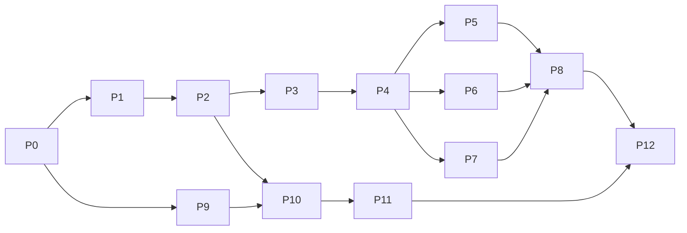

# Shift Network (flexiwork) — Implementation Plan

| | |
|---|---|
| Status | Ready for autonomous implementation |
| Date | 2026-10-10 |
| Companion | [ARCHITECTURE.md](ARCHITECTURE.md) (the *what* and *why*; this file is the *how* and *in which order*) |
| Audience | The AI agent (or engineer) implementing it, and the reviewer approving each phase |

Each task has an **ID** (`P<phase>.<n>`), the files it **creates** and the existing files it may **edit**, a list of **steps**, a **Done when** checklist and a **Verify** command or Playwright check. Commit and report per task, using the ID.

---

## 0. Rules of engagement

### 0.1 Golden rules

1. **Additive only.** Do not rename or delete any existing file, folder, table, column, route, enum value or script. Do not change the behaviour of existing endpoints or tables.
2. **Edit existing files only where §0.2 allows it**, and only in the way it describes. Anything else is a stop-and-ask (§0.5).
3. **Only claim what you verified.** If you write "done", you ran the Verify step and it passed. If a step was skipped or failed, say so and include the output.
4. **Follow the repo conventions** listed in [ARCHITECTURE §2.3](ARCHITECTURE.md#23-backend-conventions-to-copy), [§16](ARCHITECTURE.md#16-backend-conventions-for-new-code) and [§17.3](ARCHITECTURE.md#173-new-features-follow-the-existing-srcfeatures-layout). When a convention and this plan disagree, the plan wins, and you note it.
5. **Minimal tests:** only the specs listed in §16. Verify the UI with **Playwright MCP** (§17).
6. **No agent, no LLM calls.** Build only the seams listed in [ARCHITECTURE §13](ARCHITECTURE.md#13-ready-for-ai-agents-nothing-built-now).
7. **Vietnamese-only UI** for every new screen. No hardcoded user-visible strings: everything goes through `vi.js`.
8. **Money is integer VND.** Never use floats for amounts.
9. **Keep NestJS at v10.** Pick library versions compatible with NestJS 10 (e.g. `@nestjs/cqrs@10`, `@nestjs/bullmq@10`, `@nestjs/websockets@10`). Upgrading the Nest core is out of scope.

### 0.2 Allowed edits to existing files

Everything not listed here is read-only.

| File | Allowed change | Phase |
|---|---|---|
| `server-api/package.json` | add dependencies and scripts; `version` 0.0.11 → **0.1.0** | P0, P1+ |
| `server-api/env/example.env` | append new keys (Appendix A) | P0 |
| `server-api/src/shared/utils/configuration.ts` | append new keys | P0 |
| `server-api/src/app.module.ts` | add `ShiftNetworkModule` to `APP_MODULES`, conditionally on `FEATURE_SHIFT_NETWORK`; later the optional `CACHE_DRIVER=redis` switch | P1, P12 |
| `server-api/src/database/database.provider.ts` | import `SN_MODELS` from `./sn-models` and spread it into the `models` array (one line + one import) | P1 |
| `server-api/src/shared/enums/role.enum.ts` | add `WORKER = 'worker'`, `OPS = 'ops'` | P2 |
| `server-api/src/shared/constants/audit.constants.ts` | add `AuditModuleEnum` values `SN_AUTH`, `SHIFT`, `WALLET`, `WORKER_PROFILE`, `EMPLOYER_PROFILE`, `RATING`, `NOTIFICATION`, `OPS` | P2+ |
| `server-api/.eslintrc.json` | add the `overrides` block for `src/modules/*/domain/**` | P1 |
| `.nvmrc`, `.node-version` (both apps) | set to Node 22 LTS | P0 |
| `frontend/package.json` | add and replace dependencies for the Vue 3 upgrade; add scripts (`dev:vite`, `build:vite`, `preview:vite`) | P9 |
| `frontend/src/main.js` | switch to `createApp()` and import the new `src/core/plugins/vue3/*` files | P9 |
| `frontend/src/router.js` | vue-router 4 API (`createRouter` + `createWebHashHistory`), catch-all syntax, spread `snRoutes` | P9, P10 |
| `frontend/src/core/services/store/index.js` | `createStore` (Vuex 4) | P9 |
| `frontend/src/core/services/data.service.js` | replace `require("object-path")` with an `import` | P9 |
| `frontend/src/view/content/widgets/mixed/Widget1.vue` | replace the single `<v-img>` with `` | P9 |
| Vue-2-only call sites (`$listeners`/`$scopedSlots` in `TableOverview.ts`, `ProjectTableLayout.ts`, `TableProduct.ts`, `TableDefault.vue`) and any page that throws under compat | minimal Vue 3 equivalent, same behaviour | P9 |
| `frontend/src/core/services/i18n.service.js` | add `vi` (flag `media/svg/flags/220-vietnam.svg`), default `vi` | P10 |
| `frontend/src/view/layout/header/Topbar.vue` | hide the language dropdown when only one language is enabled; mount the new notification bell | P10, P11 |
| `frontend/src/view/layout/aside/Menu.vue` | wrap legacy items in `v-if="showLegacyMenu"`; add role-based Shift Network items | P10 |
| `frontend/src/view/layout/Layout.vue`, `frontend/src/core/services/store/auth.module.js` | redirect unauthenticated users to the SN login when the SN shell is on | P10 |

**Dependency removal exception (Vue 3 only):** `vue-template-compiler`, `vue-cli-plugin-vuetify`, `vuetify-loader` and `vuetify` cannot coexist with Vue 3 tooling. They may be removed from `frontend/package.json` in P9. Nothing else is removed.

### 0.3 Never

- Run `sequelize.sync({ force })` or `sync({ alter })`, or any destructive SQL on existing tables.
- Add columns or constraints to existing tables (e.g. `users`, `companies`).
- Change legacy services, controllers or their responses.
- Commit real secrets. Dev-only credentials appear only in seeders and `example.env` placeholders.
- Push to a remote, or deploy.

### 0.4 Definition of done (every task)

- [ ] Code follows the conventions; files are where this plan says.
- [ ] `cd server-api && yarn build` passes (backend tasks) / `cd frontend && yarn build:vite` passes (frontend tasks from P9 on).
- [ ] The task's Verify step was run and its output is captured in the task report.
- [ ] New env keys are documented in Appendix A and `example.env`.
- [ ] Any deviation from this plan is recorded as one new ADR line in ARCHITECTURE §20.

### 0.5 Stop and ask vs. proceed with a default

| Situation | Action |
|---|---|
| A rename, deletion or legacy behaviour change seems necessary | **Stop and ask** |
| An edit is needed in a file not in §0.2 | **Stop and ask** (unless it is a one-line import that the plan clearly implies; then record an ADR) |
| A money, legal or policy value is undefined | **Proceed** with the default in §1, mark it ⚠️ in code comments, and list it in the report |
| A library's latest version is incompatible (Nest 10, Node 22) | **Proceed** with the newest compatible version; record it |
| A Vue 3 library replacement changes visible legacy behaviour | **Stop and ask** |

### 0.6 Command cheat sheet

```bash
# Infra (repo root)
docker compose -f docker-compose.dev.yml up -d
docker compose -f docker-compose.dev.yml ps

# Backend (server-api/)
corepack enable && yarn install
yarn migrate:dev                 # uses env/development.env (src/database/config/database.config.js)
yarn build
yarn test:sn                     # new specs only (see §16; plain `yarn test` fails on the empty legacy spec)
yarn seed:sn-dev                 # dev data (P2+)
yarn start:sn-dev                # api role on PORT (7001 in dev)
yarn start:sn-worker-dev         # worker role (not needed when MESSAGE_BUS_DRIVER=memory)
curl -s localhost:7001/health

# Frontend (frontend/)
yarn install
yarn dev:vite                    # http://localhost:8080, proxies /api → :7001
yarn build:vite
```

---

## 1. Defaults used until the open questions are answered

| Topic | Default | Question |
|---|---|---|
| Shift granularity | 1 shift = 1 worker slot; headcount N → N shifts sharing `job_ref` | Q1 |
| Escrow timing | Held right after acceptance; funding deadline 30 min (or start − 30 min) | Q2 |
| Worker client | Mobile-first pages in the same Vue app (PWA-capable) | Q3 |
| Worker login | Phone (+84) or email + password; OTP later | Q4 |
| Platform fee | 10 % of gross, paid by the employer on top of gross | Q5 |
| PIT withholding | 10 % when one payment is ≥ 2,000,000 VND (configurable, `SN_PIT_*`) | Q6 |
| Timers and cancellation | ARCHITECTURE §5.5 and §5.6 values | Q7 |
| Infra | Self-hosted dev via compose; Elasticsearch 8 | Q8 |
| Legacy security issues | Documented, not changed | Q9 |
| Address model | Free text + `province_code` + `ward_code` + lat/lng | Q11 |
| Version control | `git init` at the repo root before P0.2 | Q12 |

---

## 2. Phase overview

| Phase | Name | Depends on | Output |
|---|---|---|---|
| P0 | Groundwork | — | Node LTS, dev infra, env/config, version bump, scripts |
| P1 | Backend platform | P0 | Event store, outbox/inbox, Kafka/in-memory bus, CQRS, Redis, timers, ES, worker process, isolation interceptor |
| P2 | Identity and profiles | P1 | Worker/employer registration and login, profiles, work locations, skills, dev seed |
| P3 | Wallet, ledger, escrow | P1, P2 | Double-entry ledger, fake gateway, top-up/payout, reconciliation |
| P4 | Shift core | P2, P3 | Event-sourced Shift, lifecycle commands, saga, timers, attendance, views |
| P5 | Matching and search | P4 | ES projections, matching, nearby search |
| P6 | Ratings and reputation | P4 | Ratings, reliability/rating projections |
| P7 | Notifications | P4 | In-app + Socket.IO, Web Push, email, FCM adapter |
| P8 | Ops, exceptions, autonomy | P4–P7 | Exception queue, decision points, DLQ admin, introspection |
| P9 | Frontend Vue 3 upgrade | P0 (parallel with P1–P3) | Vite + Vue 3.5 compat; legacy pages render |
| P10 | Frontend Vietnamese shell | P9, P2 | `vi` locale, SN login, menu, role landing |
| P11 | Frontend features | P10 + matching backend phases | Employer, worker, wallet, notifications, ops screens |
| P12 | Hardening and end-to-end runs | all | Rate limits, optional Redis cache, AsyncAPI, full Playwright scenarios |



---

## 3. P0 — Groundwork

### P0.1 Version control baseline

- **Goal:** make every later change diffable.
- **Steps:** if the root `flexiwork/` is not a git repository, run `git init` and make a single commit of the current tree (respect the existing `.gitignore` files). Do **not** add a remote. Skip and report if the user declined (Q12).
- **Done when:** `git status` is clean after the baseline commit.

### P0.2 Node LTS

- **Edit:** `server-api/.nvmrc`, `server-api/.node-version`, `frontend/.nvmrc`, `frontend/.node-version` → `22` (current LTS line; ⚠️ Node 21.7.3 is EOL).
- **Verify:** `node -v` → v22.x; `cd server-api && yarn install && yarn build` passes (checks that the `canvas@3.1.0` resolution builds on 22).

### P0.3 Dev infrastructure

- **Create:** `docker-compose.dev.yml` (repo root).
- **Services:**
  - `postgres:16` (db `flexiwork_dev`);
  - `redis:7`;
  - `apache/kafka` KRaft single node (advertised `localhost:9092`, auto-create topics **off**);
  - `elasticsearch:8.x` (`discovery.type=single-node`, `xpack.security.enabled=false`, `ES_JAVA_OPTS=-Xms1g -Xmx1g`);
  - profile `tools`: `kafka-ui`, `kibana`.
- Healthchecks and named volumes for every service.
- **Done when:** `docker compose -f docker-compose.dev.yml ps` shows all core services `healthy`.

### P0.4 Environment and configuration

- **Edit:** `server-api/env/example.env` (append Appendix A keys with placeholders) and `server-api/src/shared/utils/configuration.ts` (append the same keys, with defaults where safe).
- **Done when:** the app boots unchanged with the old env file (all new keys optional, with defaults).

### P0.5 Version and scripts

- **Edit:** `server-api/package.json`:
  - `version` → `0.1.0` (new migrations go to `src/database/migrations/v0.1.0/`, per ✅ `.sequelizerc`);
  - add scripts:
    - `start:sn-dev`: `cross-env NODE_ENV=development nest start --watch` (uses the default `./env` folder; ✅ `app.module.ts` falls back to `${cwd}/env`; the existing `start-dev` hardcodes `/Users/baohoang/Desktop/115/...`);
    - `start:sn-worker-dev`: `cross-env NODE_ENV=development nest start --watch --entryFile main.worker`;
    - `test:sn`: `jest --testPathPattern "src/(shared|modules/(shift|wallet|matching|rating|notification|ops|sn-auth|worker-profile|employer-profile|shift-network))/"`;
    - `seed:sn-dev`: `cross-env NODE_ENV=development ts-node -r tsconfig-paths/register src/database/seeders/sn-dev.seeder.ts`.
- **Risk check before bumping (R-03):** after the bump, `migrate:*` only runs `v0.1.0`. Confirm (or note in the report) that the `v0.0.11` migrations are already applied in every environment.
- **Verify:** `yarn build`; `yarn start:sn-dev` → `curl localhost:7001/health` returns `{"status":"Healthy",...}`.

---

## 4. P1 — Backend platform

### P1.1 Event contracts and shared kernel

- **Create:**
  - `src/shared/events/{event-envelope.ts, actor.ts, domain-event.ts, event-registry.ts, upcaster.ts, index.ts}`
  - `src/shared/contracts/events/{shift.events.ts, wallet.events.ts, identity.events.ts, rating.events.ts, exception.events.ts, decision.events.ts, index.ts}` (type names as constants + payload interfaces; catalog in [ARCHITECTURE §6.6](ARCHITECTURE.md#66-event-catalog-v1))
  - `src/shared/contracts/commands/wallet.commands.ts`
  - `src/shared/domain/{money.ts, geo-point.ts, time-range.ts, index.ts}`
- **Done when:** compiles; `Money` rejects non-integers and unsafe integers; `GeoPoint.distanceTo()` (haversine) exists.

### P1.2 Event store, outbox and inbox tables

- **Create models** (`src/database/models/`): `event-store.model.ts`, `aggregate-snapshots.model.ts`, `outbox-messages.model.ts`, `processed-messages.model.ts`, `projection-checkpoints.model.ts`.
- **Create** `src/database/sn-models.ts` (exports `SN_MODELS = [...]`). **Edit** `database.provider.ts` per §0.2.
- **Create migration:** `src/database/migrations/v0.1.0/<timestamp>-sn-event-infrastructure.js`, using the SQL in [ARCHITECTURE §7.3](ARCHITECTURE.md#73-storage-schema-proposed-migration-v010). Every statement is idempotent; `down` drops only these tables.
- **Verify:** `yarn migrate:dev` twice (the second run is a no-op); `psql -c '\d event_store'` shows `UNIQUE (stream_id, stream_version)`.

### P1.3 Unit of work and event-sourced repository

- **Create:** `src/shared/event-store/{unit-of-work.ts, event-store.service.ts, aggregate-root.ts, event-sourced.repository.ts, concurrency.error.ts, event-store.module.ts}`.
- **Rules:**
  - `UnitOfWork` injects the existing `'SEQUELIZE'` provider (✅ `database.provider.ts`) and runs `sequelize.transaction(async t => ...)`;
  - `save()` appends events, outbox rows (via `OutboxService.enqueue(t, envelope)`) and `extraWrites(t)` in **one** transaction;
  - a unique violation on `(stream_id, stream_version)` becomes `ConcurrencyError`.
- **Done when:** `event-sourced.repository.spec.ts` passes. It uses a fake store (in-memory) and covers load/apply/save and the version conflict.

### P1.4 Messaging (Kafka + in-memory) with outbox relay and inbox

- **Create:** `src/shared/messaging/{message-broker.port.ts, kafka.message-broker.ts, in-memory.message-broker.ts, outbox.service.ts, outbox-relay.service.ts, inbox.service.ts, base-projector.ts, consume-events.decorator.ts, consumer-registry.service.ts, topics.constant.ts, messaging.module.ts}`.
- **Dependencies:** `kafkajs`.
- **Behaviour:** as in [ARCHITECTURE §6.4–6.5](ARCHITECTURE.md#64-kafka-topics):
  - `MessagingModule.forRoot({ driver: MESSAGE_BUS_DRIVER, role })`;
  - the relay runs only in the worker role, or in api when `driver=memory`;
  - `@ConsumeEvents({ topic, group, types })` handlers are discovered through Nest `DiscoveryService`;
  - topics are created on worker boot (`admin.createTopics`, partitions from config);
  - 5 retries with backoff, then `sn.dlq.v1`.
- **Done when:** `outbox-relay.spec.ts` passes. With the in-memory broker it covers: published once, duplicate delivery skipped by the inbox, and a failing handler ending in the DLQ.

### P1.5 CQRS wiring

- **Dependencies:** `@nestjs/cqrs@^10`.
- **Convention:** commands and queries are classes under `application/commands|queries`; handlers carry `@CommandHandler`/`@QueryHandler`; commands carry `actor`, `idempotencyKey?`, `correlationId`.
- **Done when:** `ShiftNetworkModule` imports `CqrsModule` and builds. The first real command (P2/P3) runs through `CommandBus`.

### P1.6 Redis: locks and idempotency

- **Dependencies:** `ioredis`.
- **Create:** `src/shared/redis/{redis.module.ts, lock.service.ts, idempotency.interceptor.ts}`, `src/shared/decorators/idempotent.decorator.ts`. Import it by path; do not add it to ✅ `src/shared/decorators/index.ts` (that would be an edit outside §0.2).
- **Behaviour:**
  - `@Idempotent()` requires the `Idempotency-Key` header on POST (400 `IDEMPOTENCY_KEY_REQUIRED` if missing);
  - it stores `{status, body}` under `idem:{userId}:{route}:{key}` for 24 h and replays it;
  - a concurrent duplicate gets 409 `IDEMPOTENCY_IN_PROGRESS`.
- **Done when:** `lock.service` acquires/releases with a token, and `idempotency.interceptor.spec.ts` passes with a fake Redis.

### P1.7 Timers (BullMQ)

- **Dependencies:** `bullmq`, `@nestjs/bullmq@^10`.
- **Create:** `src/shared/timers/{timers.module.ts, timer.service.ts, timer-handler.decorator.ts, timers.processor.ts}`.
- **API:** `schedule(type, subjectId, runAt, payload, dedupeKey)`, `cancel(dedupeKey)`. The processor runs only in the worker role (or in api with the memory driver). Apply `SN_TIMER_SPEEDUP` only when `NODE_ENV=development`.
- **Done when:** a dev-only spec or log shows a job scheduled +2 s firing once even if scheduled twice.

### P1.8 Search module

- **Dependencies:** `@elastic/elasticsearch@^8`.
- **Create:** `src/shared/search/{search.module.ts, index-manager.service.ts, indices/sn_shifts_v1.json, indices/sn_workers_v1.json}`. `IndexManager.ensure()` creates versioned indexes + aliases on worker boot (the analyzer is in [ARCHITECTURE §9.5](ARCHITECTURE.md#95-index-definitions-proposed-srcsharedsearchindicesjson)).
- **Verify:** `curl -s localhost:9200/_alias/sn_shifts` lists `sn_shifts_v1`; `_analyze` with `vi_folded` on "nhà hàng" returns tokens including `nha`, `hang`.

### P1.9 Worker process and aggregator module

- **Create:**
  - `src/main.worker.ts` (`NestFactory.createApplicationContext(WorkerModule)`, same logger choice as ✅ `main.ts`, but it **does not** log `process.env`);
  - `src/worker.module.ts` (ConfigModule with the same `envFilePath` logic as ✅ `app.module.ts`, DatabaseModule, EventStore, Messaging(role=worker), Redis, Timers, Search, and the SN context modules' worker parts);
  - `src/modules/shift-network/shift-network.module.ts` (aggregator for the api role).
- **Edit:** `src/app.module.ts`: append `ShiftNetworkModule` to `APP_MODULES` only when `process.env.FEATURE_SHIFT_NETWORK === 'true'`.
- **Verify:** `yarn start:sn-worker-dev` logs "relay started", "topics ensured", "indices ensured"; the api still serves legacy routes (`curl /health`).

### P1.10 Legacy isolation and correlation id

- **Create:**
  - `src/shared/interceptors/sn-legacy-isolation.interceptor.ts`, registered as `APP_INTERCEPTOR` inside `ShiftNetworkModule` and controlled by `SN_LEGACY_ISOLATION=true`. It rejects (403 `SN_ROUTE_FORBIDDEN`) users with role `worker`/`ops` on any path not starting with `/api/sn/`, except `/api/logout` and `/health`.
  - `src/shared/middlewares/correlation-id.middleware.ts`, applied to `api/sn/(.*)` by `ShiftNetworkModule implements NestModule`.
  - `src/shared/controllers/sn-base.controller.ts` (`SnBaseController extends BaseController`; adds `code` in error responses) and `src/shared/utils/coded.error.ts`.
- **ESLint:** add the domain-layer override ([ARCHITECTURE §15.2](ARCHITECTURE.md#152-core-module-template-shift-wallet-matching)).
- **Verify (after P2):** a worker token on `GET /api/users` → 403; an admin token → unchanged legacy response.

---

## 5. P2 — Identity and profiles

### P2.1 Roles

- **Edit:** `role.enum.ts` (+`WORKER`, `OPS`) and `audit.constants.ts` (+SN modules).
- **Note:** ✅ `AuthService.generateToken` gives non-employee/manager roles `ADMIN_TOKEN_EXPIRES_IN`. Accept that for workers (no edit to `auth.service.ts`).

### P2.2 Tables

- **Create models + migration** `v0.1.0/<ts>-sn-identity.js`:
  - `worker_profiles`: `user_id` UNIQUE, `full_name`, `phone_e164` UNIQUE, `dob`, `skill_codes TEXT[]`, `home_lat`, `home_lng`, `radius_km` (default 10), `verified` (bool), `suspended` (bool), `reliability_score` (int, default 80), `rating_avg` (numeric), `rating_count` (int), `consents` JSONB, `availability` JSONB, timestamps;
  - `employer_profiles`: `company_id` UNIQUE, `legal_name`, `tax_code`, `business_type`, `phone_e164`, `address`, `province_code`, `ward_code`, `lat`, `lng`, `verified`, `rating_avg`, `rating_count`, timestamps;
  - `work_locations`: uuid, `company_id`, `name`, `address`, `province_code`, `ward_code`, `lat`, `lng`, `geofence_radius_m` (default 150), `qr_required` (bool), `qr_secret`, `active`, timestamps;
  - `skills`: `code` PK, `name_vi`, `active`.
- **Seed** `skills` in the migration with: `phuc_vu` (Phục vụ), `pha_che` (Pha chế), `phu_bep` (Phụ bếp), `rua_bat` (Rửa bát), `thu_ngan` (Thu ngân), `ban_hang` (Bán hàng), `boc_xep` (Bốc xếp), `kho_van` (Kho vận), `giao_hang` (Giao hàng), `tap_vu` (Tạp vụ / Vệ sinh), `le_tan` (Lễ tân), `su_kien` (Sự kiện / PG), `bao_ve` (Bảo vệ).

### P2.3 SN auth module

- **Create:** `src/modules/sn-auth/` (flat convention: `controllers/sn-auth.controller.ts`, `services/sn-auth.service.ts`, `dto/*`, `sn-auth.module.ts`, `sn-auth.provider.ts`). Import ✅ `AuthModule` to reuse `AuthService.generateToken`.
- **Endpoints** (all `@PublicRoute()` except `/me`; throttled in P12):
  - `POST /api/sn/auth/worker/register` `{ phone, password, full_name, email? }`: phone → E.164 via `libphonenumber-js` (VN); create a `users` row (`role='worker'`, `company_id=null`, `is_active=true`, `password=hashSync(...)` from ✅ `@node-rs/bcrypt`) and the `worker_profiles` row in one transaction; outbox `identity.worker_registered`.
  - `POST /api/sn/auth/employer/register` `{ company_name, tax_code, email, password, phone, address, province_code?, ward_code? }`: create `companies` (`language='vi'`, `currency='VND'`), a `users` row (`role='admin'`, `company_id`) and `employer_profiles`; outbox `identity.employer_registered`. **Do not** call legacy `UsersService.register` (it seeds ArchApp defaults and enforces DE/CHF templates).
  - `POST /api/sn/auth/login` `{ identifier, password, company_id? }`: a phone resolves through `worker_profiles`; an email resolves through `users`, restricted to SN users (role worker/ops, or admin/manager with an `employer_profiles` row). Several employer accounts with the same email → return `{ error, companies }` like ✅ legacy `login`. The response shape is `{ access_token, user }`, the same as legacy.
  - `GET /api/sn/me` → `{ user, role, worker_profile? | employer_profile?, company? }`.
- **Verify:** curl the register → login → `/api/sn/me` flow for both roles; a worker token on `GET /api/users` → 403 (P1.10).

### P2.4 Profile modules

- **Create:** `src/modules/worker-profile/` (`GET/PUT /api/sn/workers/me`, `GET /api/sn/skills`) and `src/modules/employer-profile/` (`GET/PUT /api/sn/employers/me`, `GET/POST /api/sn/work-locations`, `PUT /api/sn/work-locations/:id`, `GET /api/sn/work-locations/:id/check-in-qr` → current rotating token + expiry).
- Each write puts its `identity.*` event in the outbox inside the same transaction.

### P2.5 Dev seed

- **Create:** `src/database/seeders/sn-dev.seeder.ts`. It refuses to run unless `NODE_ENV=development`. Contents:
  - 1 ops user;
  - 2 employers with work locations: "Nhà hàng Phố Cổ" (10.7769, 106.7009) and "Kho Hà Nội" (21.0285, 105.8542);
  - 20 verified workers spread within 8 km of each location, with mixed skills;
  - one **legacy** company + admin user (`language='de'`, `currency='CHF'`) for the P9 legacy smoke.
- Dev credentials are printed to the console only.
- **Verify:** `yarn seed:sn-dev` twice (idempotent: upsert by email/phone).

---

## 6. P3 — Wallet, ledger and escrow

### P3.1 Ledger tables

- **Create models + migration** `v0.1.0/<ts>-sn-ledger.js` from [ARCHITECTURE §8.3](ARCHITECTURE.md#83-schema-proposed). Add a constraint trigger that checks Σ `amount_vnd` = 0 per `journal_id` at commit (`DEFERRABLE INITIALLY DEFERRED`). Seed the platform accounts (`platform:fee_revenue`, `platform:pit_payable`, `gateway:fake:clearing`).

### P3.2 Domain

- **Create:**
  - `src/modules/wallet/domain/{journal-templates.ts, ledger-posting.ts, account-code.ts, errors/*.ts}`
  - `domain/policies/{fee.policy.ts, pit-withholding.policy.ts}` (config-driven: `SN_PLATFORM_FEE_PCT`, `SN_PIT_RATE_PCT`, `SN_PIT_THRESHOLD_VND`)

### P3.3 Application and infrastructure

- **Commands:** `TopUpWallet`, `HoldEscrow`, `ReleaseEscrow`, `RefundEscrow`, `PayCancellationCompensation`, `RequestPayout`, `SettlePayout`, `FailPayout`.
- **Queries:** `GetWallet`, `GetStatement` (paginated; reuse ✅ `getOrderOptions`), `GetEscrow(shiftId)`.
- **Infrastructure:** `SequelizeLedgerRepository`. It locks balances `FOR UPDATE` in ascending `account_id` order, creates accounts lazily (`employer:{id}`, `worker:{id}`, `escrow:shift:{id}`, `payout_pending:{id}`), and writes journal + entries + balances + an outbox `wallet.*` event in one transaction.
- **`HoldEscrow` with insufficient funds:** emits `wallet.escrow_hold_failed{reason:'insufficient_funds'}` (no exception thrown to the saga).
- **Gateway:** `FakePaymentGateway` behind the `'PAYMENT_GATEWAY'` token ([ARCHITECTURE §8.7](ARCHITECTURE.md#87-payment-gateway-port-adapter)).

### P3.4 Endpoints

- `GET /api/sn/wallets/me`
- `GET /api/sn/wallets/me/statement`
- `POST /api/sn/wallets/me/top-ups` `{ amount_vnd }` (employer)
- `POST /api/sn/wallets/me/payouts` `{ amount_vnd, bank_account }` (worker; auto-approved ≤ `SN_AUTO_PAYOUT_MAX_VND`, otherwise an exception case after P8)
- `POST /api/sn/payments/webhooks/:provider` (`@PublicRoute`, raw-body HMAC check, idempotent by `provider_ref`)

### P3.5 Reconciliation

- **Create:** `src/modules/wallet/application/reconciliation.job.ts` (BullMQ repeatable, 02:00 Asia/Ho_Chi_Minh) running the checks in [ARCHITECTURE §8.6](ARCHITECTURE.md#86-invariants-and-reconciliation). Until P8 it logs the result; P8 wires the exception case and the kill switch.

### P3 Verify

- `yarn test:sn` → `ledger.spec.ts` (all 3 worked examples, partial release, PIT threshold boundary 1,999,999 / 2,000,000, Σ = 0 for every template) and `money.spec.ts` pass.
- curl: top up 1,000,000 VND (fake) → webhook → `GET /wallets/me` shows 1,000,000; top up `100013` → failed intent, no balance change.

---

## 7. P4 — Shift core

### P4.1 Domain

- **Create** (no framework imports):
  - `src/modules/shift/domain/{shift.aggregate.ts, shift-status.enum.ts, shift-state-machine.ts, events/*.event.ts, errors/*.error.ts}`
  - `domain/policies/{pricing.policy.ts, cancellation.policy.ts, no-show.policy.ts, completion.policy.ts}`
- States, transitions and guards exactly as [ARCHITECTURE §5](ARCHITECTURE.md#5-shift-lifecycle).

### P4.2 Tables

- **Create models + migration** `v0.1.0/<ts>-sn-shift.js`:
  - `shift_views`: projection with the columns needed for lists, filters and detail, `version`, indexes on `(company_id, status, start_at)` and `(worker_id, start_at)`;
  - `worker_shift_reservations`: `CREATE EXTENSION IF NOT EXISTS btree_gist` + the exclusion constraint ([ARCHITECTURE §9.6](ARCHITECTURE.md#96-no-double-booking-three-layers)).
- If the extension cannot be created (R-07), **stop and ask**.

### P4.3 Commands, queries, controllers

- **Commands** (one handler each): `PostShift` (headcount → N streams, same `job_ref`), `DirectOffer`, `OfferShift`, `DeclineOffer`, `ExpireOffer`, `AcceptShift` (Redis lock `lock:shift:{id}` + reservation as `extraWrites`), `RecordEscrowFunded`, `FailEscrowFunding`, `WithdrawFromShift`, `CheckIn`, `CheckOut`, `AutoCheckOut`, `RecordNoShow`, `Rematch`, `ConfirmCompletion`, `AutoConfirmCompletion`, `DisputeCompletion`, `ResolveDispute`, `RecordPaymentReleased`, `RateShift`, `CloseRatingWindow`, `CancelShift`, `ExpireShift`.
- **Queries:** `ListEmployerShifts`, `GetShift`, `ListWorkerShifts`, `ListWorkerOffers`, `GetAvailableTransitions`, `GetShiftTimeline`.
- **Controllers** (`@Controller('api/sn')`, `@Idempotent()` on every POST, role guards, `@AuditModule(AuditModuleEnum.SHIFT)`):
  - `employer-shift.controller.ts`:
    - `POST /shifts`
    - `GET /employer/shifts`
    - `POST /shifts/:id/direct-offer`
    - `POST /shifts/:id/cancel`
    - `POST /shifts/:id/confirm-completion`
    - `POST /shifts/:id/dispute`
  - `worker-shift.controller.ts`:
    - `GET /worker/offers`
    - `GET /worker/shifts`
    - `POST /shifts/:id/accept`
    - `POST /shifts/:id/decline`
    - `POST /shifts/:id/withdraw`
    - `POST /shifts/:id/check-in`
    - `POST /shifts/:id/check-out`
  - `shift.controller.ts` (participants):
    - `GET /shifts/:id`
    - `POST /shifts/:id/ratings`
    - `GET /shifts/:id/available-transitions`
    - `GET /shifts/:id/timeline`
- Command responses return the new aggregate state and `version` (read-your-writes).

### P4.4 Saga, timers, projections

- **Create:**
  - `application/sagas/shift-fulfillment.saga.ts` (group `sn-saga-shift`):
    - `shift.accepted` → `HoldEscrow`;
    - `wallet.escrow_held` → `RecordEscrowFunded`;
    - `wallet.escrow_hold_failed` → notify only (the escrow-deadline timer decides);
    - `shift.completed` → `ReleaseEscrow`;
    - `wallet.escrow_released` → `RecordPaymentReleased`;
    - `shift.cancelled` / `shift.expired` → `RefundEscrow` or `PayCancellationCompensation` (when escrow is held);
    - on worker withdraw, escrow stays held.
  - Timer scheduling per [ARCHITECTURE §5.5](ARCHITECTURE.md#55-timers), with handlers that check the state first.
  - `infrastructure/shift-view.projector.ts` (group `sn-proj-shift-view`, extends `BaseProjector`).

### P4.5 Attendance chain

- **Create:** `application/check-in/{check-in.chain.ts, state.check.ts, time-window.check.ts, gps-accuracy.check.ts, geofence.check.ts, qr-token.check.ts}` and `infrastructure/work-location.reader.ts` (port over `work_locations`).

### P4 Verify

- `yarn test:sn`:
  - `shift-state-machine.spec.ts`: every valid transition, plus at least one invalid transition per state;
  - `shift.aggregate.spec.ts`: given/when/then for the happy path, no-show → rematch, dispute → partial pay, late employer cancel;
  - `pricing.policy.spec.ts`: day, night split at 22:00, holiday multiplier;
  - `check-in.chain.spec.ts`: geofence in/out, time window edges.
- 🆕 `server-api/test/sn/smoke-happy-path.sh` (curl + jq, `MESSAGE_BUS_DRIVER=memory`, `SN_TIMER_SPEEDUP=60`) runs: employer login → top up 2,000,000 → post a shift (Nhà hàng Phố Cổ) → direct offer to a seeded worker → worker accepts → status `ESCROW_FUNDED` → check-in at the location coordinates → check-out → employer confirms → status `PAID` → worker wallet = gross − PIT. The script exits non-zero on any mismatch.
- `smoke-no-show.sh`: accept, skip check-in, wait for the sped-up grace → status `POSTED` (rematch) or `CANCELLED` + refund.

---

## 8. P5 — Matching and search

- **P5.1 Projectors:** `src/modules/matching/infrastructure/{shift-search.projector.ts, worker-search.projector.ts}` (groups `sn-proj-es-shifts`, `sn-proj-es-workers`). Only `POSTED`/`MATCHED` shifts stay in `sn_shifts`.
- **P5.2 Domain:** `src/modules/matching/domain/{eligibility/*.specification.ts, ranking/weighted-score.strategy.ts, dispatch.policy.ts}`. Weights come from config.
- **P5.3 Application:** `application/match-shift.handler.ts` (group `sn-matching`) on `shift.posted`, `shift.rematch_requested`, the last `shift.offer_declined`, and `shift.offer_expired`. Ports: `CandidateSearch` (ES adapter + Postgres bounding-box fallback). It sends `OfferShift` through `CommandBus` and stores the ranking snapshot.
- **P5.4 Endpoint:** `GET /api/sn/shifts/nearby?lat&lng&radius_km&skill&from&to&q` (worker).
- **P5.5 Rebuild tool:** `yarn sn:rebuild-projection <shift-view|es-shifts|es-workers>` (new script + `src/shared/messaging/rebuild-projection.ts`).
- **Verify:**
  - `matching.spec.ts` (eligibility composition + ranking order with fixed inputs) passes;
  - posting a seeded shift creates an offer to eligible workers within about 2 s;
  - `GET /shifts/nearby?q=nha hang` near (10.7769, 106.7009) returns it;
  - with ES stopped, nearby search still answers through the fallback (log line `CandidateSearch fallback=postgres`).

---

## 9. P6 — Ratings and reputation

- **Create:** `src/modules/rating/` (flat): `ratings` model + migration (`UNIQUE(shift_id, rater_id)`, stars 1–5 CHECK, `tags TEXT[]`, comment).
  - Projector on `shift.rated` → `ratings`.
  - `ReputationProjector`:
    - on `shift.rated`, `shift.no_show_recorded`, `shift.worker_withdrew`, late check-in → update `worker_profiles.rating_avg/count/reliability_score`;
    - on worker ratings of employers → update `employer_profiles.rating_avg/count`;
    - emit `rating.reputation_changed`.
- **Reliability defaults:** start 80; completed +2 (cap 100); late check-in > 15 min −3; late withdrawal −10; no-show −20; floor 0.
- **Verify:** after the happy-path smoke, both ratings stored; status `RATED`; `GET /api/sn/workers/me` shows updated `rating_avg`.

---

## 10. P7 — Notifications

- **Dependencies:** `@nestjs/websockets@^10`, `@nestjs/platform-socket.io@^10`, `socket.io`, `@socket.io/redis-adapter`, `web-push`, `firebase-admin`.
- **Create:** `src/modules/notification/` (flat + `channels/`):
  - models + migration for `notifications`, `notification_deliveries` (`UNIQUE(event_id, user_id, channel)`), `push_subscriptions`, `notification_preferences`;
  - `constants/notification-rules.constant.ts` ([ARCHITECTURE §11.1](ARCHITECTURE.md#111-pipeline));
  - channels `in-app`, `web-push`, `email` (reuses ✅ `SendMailService`; templates in `src/templates/mail-templates/vi/`), `fcm` (on only if `FCM_CREDENTIALS_PATH` is set), `sms` (stub);
  - `src/templates/notification-templates/vi.json`;
  - `notifications.gateway.ts` (namespace `/sn`, JWT handshake, rooms).
- **Endpoints:**
  - `GET /api/sn/notifications`
  - `POST /api/sn/notifications/:id/read`
  - `POST /api/sn/notifications/read-all`
  - `GET /api/sn/push/vapid-public-key` (public)
  - `POST /api/sn/push-subscriptions`
  - `DELETE /api/sn/push-subscriptions/:id`
  - `GET/PUT /api/sn/notification-preferences`
- **Verify:** during the happy-path smoke, `notifications` rows appear for each rule; a test socket client receives `notification.created`; replaying the same event creates no duplicate deliveries.

---

## 11. P8 — Ops, exceptions and autonomy

- **Create models + migration:** `exception_cases`, `autonomy_policies` (seeded with the decision points in [ARCHITECTURE §13](ARCHITECTURE.md#13-ready-for-ai-agents-nothing-built-now), item 4), `decision_records`, `dlq_messages`.
- **Create:**
  - `src/shared/autonomy/{decision-points.constant.ts, decision-provider.port.ts, rule-based.decision-provider.ts, autonomy-policy.service.ts}`;
  - wire it into: no-show handling, auto-confirm, payout approval, worker suspension suggestions, reconciliation kill switch (`payouts.enabled`).
- **Create** `src/modules/ops/` with:
  - exception openers (consumer group `sn-ops`) for:
    - `shift.disputed`, auto checkout, repeated no-show, late withdrawals;
    - `wallet.payout_failed`, `matching_exhausted`;
    - DLQ messages (group `sn-ops-dlq` → `dlq_messages`);
    - reconciliation mismatch;
  - endpoints (role `ops`):
    - `GET /api/sn/ops/exceptions`
    - `GET /api/sn/ops/exceptions/:id`
    - `POST /api/sn/ops/exceptions/:id/acknowledge`
    - `POST /api/sn/ops/exceptions/:id/resolve` `{ action, params, note }` (executes normal commands with actor = ops user)
    - `GET /api/sn/ops/autonomy-policies`
    - `PUT /api/sn/ops/autonomy-policies/:decision_point`
    - `GET /api/sn/ops/dlq`
    - `POST /api/sn/ops/dlq/:id/replay`
    - `POST /api/sn/ops/reconciliation/run`
    - `GET /api/sn/ops/reconciliation/latest`
    - `GET /api/sn/health/deps`
- **Verify:** dispute smoke (`smoke-dispute.sh`): dispute → exception case OPEN → ops resolves with `approved_minutes` → status `PAID` with partial release; `decision.recorded` rows exist for auto-confirm and payout approval.

---

## 12. P9 — Frontend upgrade to Vue 3.5 + Vite (`@vue/compat`)

### P9.0 Baseline (before changes)

- Install with yarn 4 (`packageManager` ✅). Run the legacy app once (`yarn serve`) against the seeded backend. With Playwright MCP, log in as the seeded **legacy** admin and capture snapshots and screenshots of these routes: `/login`, `/dashboard`, `/offer`, `/offer/create`, `/project`, `/task`, `/timesheet`, `/invoice`, `/expense`, `/product`, `/settings`. Store the evidence outside the repo (scratch folder) and list it in the report.
- If the legacy app cannot start on Node 22 (webpack 4 + OpenSSL), record that and use the Vite build as the first working baseline.

### P9.1 Vite tooling (additive)

- **Create:**
  - `frontend/vite.config.ts`, with:
    - `@vitejs/plugin-vue` with `compatConfig: { MODE: 2 }`;
    - aliases `vue → @vue/compat`, `@ → src`, `^~(.*)$ → $1`;
    - `resolve.extensions` including `.vue`;
    - `envPrefix: ['VITE_','VUE_APP_']`;
    - `define` for `process.env.BASE_URL` and `process.env.VUE_APP_API_URL`;
    - SCSS `additionalData` identical to `vue.config.js` `prependData`;
    - dev server port 8080 with proxy `/api → VITE_DEV_API_PROXY || http://localhost:7001` and `/socket.io` (ws);
  - `frontend/index.html`: `lang="vi"`, the same fonts as `public/index.html`, `<script type="module" src="/src/main.js">`.
- **Edit** `package.json` scripts: add `dev:vite`, `build:vite`, `preview:vite`. Keep the Vue CLI scripts. Do **not** add a `build` script (see Q13).

### P9.2 Dependencies

- **Add:** `vue@^3.5`, `@vue/compat@^3.5`, `@vue/compiler-sfc@^3.5`, `vue-router@^4`, `vuex@^4`, `vue-i18n@^11`, `pinia`, `portal-vue@^3`, `vuedraggable@^4`, `vue3-apexcharts`, `vue-inline-svg@^3` (or newer), `vue3-perfect-scrollbar`, `ag-grid-vue3` (same major as `ag-grid-community` 27), `vite`, `@vitejs/plugin-vue`, `sass` (a version that still compiles Metronic: use `silenceDeprecations` instead of rewriting SCSS).
- **Remove** only per §0.2. Keep `bootstrap-vue@2.23.1`.

### P9.3 App bootstrap

- **Create** `src/core/plugins/vue3/{bootstrap-vue.js, i18n.js, portal.js, apexcharts.js, inline-svg.js, perfect-scrollbar.js, metronic.js (re-exports the window globals from the existing plugin), meta-title.js}`. `meta-title.js` is a global mixin that sets `document.title` from `this.$options.metaInfo?.title`, so the 37 files using `metaInfo` need no edit.
- **Edit** `main.js`: `createApp(App)`, `app.use(router).use(store).use(i18n)`, install the plugins above, keep the `beforeEach` logic, `app.mount('#app')`. Keep `moment.tz.setDefault("Europe/London")` as is (legacy behaviour).
- **Edit** `router.js` (`createRouter({ history: createWebHashHistory(), routes })`; `path: "*"` → `/:pathMatch(.*)*`) and `store/index.js` (`createStore`).

### P9.4 Compat fixes

- Fix only what breaks on the baseline routes:
  - the `$listeners`/`$scopedSlots` sites;
  - `data.service.js` `require`;
  - `Widget1.vue` `<v-img>`;
  - vuelidate 0.7: if it fails under compat, migrate those components to `@vuelidate/core`, keeping the same rules (23 files; stop and ask if behaviour would change).
- Leave compat warnings for later; fix uncaught errors now.

### P9 Verify (gate)

- `yarn build:vite` passes.
- Playwright MCP: the same routes as P9.0 render. `browser_console_messages` shows **no uncaught errors** (compat deprecation warnings are allowed), and the main tables and forms are visible as in the baseline. Report the visual differences.

---

## 13. P10 — Frontend Vietnamese shell

- **P10.1 Locale:**
  - create `src/core/config/i18n/vi.js` (`sn.*` namespace, layout/menu/auth/common keys, `sn.errors.<CODE>` for every backend error code, `sn.status.<STATE>` for the shift states);
  - in `src/core/plugins/vue3/i18n.js` set `locale:'vi'`, `fallbackLocale:'en'`, `legacy:true`, `globalInjection:true`;
  - edit `i18n.service.js` (add `vi`, default `vi`);
  - edit `Topbar.vue` (hide the language dropdown when `languages.length === 1` or `VITE_LANGUAGE_SWITCHER !== 'true'`).
- **P10.2 Helpers:**
  - create `src/common/vnFormat.ts` (`formatVnd`, `formatDateTimeVn`, `formatDateVn`, `formatPhoneVn`, `minutesToHoursLabel`), using `Intl` with `Asia/Ho_Chi_Minh` and no moment;
  - create `src/api/sn-endpoints.ts`;
  - create `src/core/stores/{session.store.ts, notifications.store.ts}` (Pinia).
- **P10.3 SN auth feature:**
  - create `src/features/sn-auth/` (pages `Login` (Đăng nhập), `WorkerRegister`, `EmployerRegister`; service `sn-auth.service.ts`);
  - create `src/sn-routes.js` with SN routes (`/sn/login`, `/sn/register/worker`, `/sn/register/employer`, plus placeholders for P11) and a role guard on `meta.roles`;
  - edit `router.js` to spread them;
  - edit `Layout.vue` / `auth.module.js` so unauthenticated users go to `/sn/login`, and SN sessions use `GET /api/sn/me` instead of `/api/verify`.
- **P10.4 Menu:** edit `Menu.vue`: legacy items behind `showLegacyMenu` (`import.meta.env.VITE_SHOW_LEGACY_MENU === 'true'`); SN items per role (worker: Ca gần bạn, Lời mời, Ca của tôi, Ví, Hồ sơ; employer: Ca làm việc, Đăng ca, Địa điểm, Ví, Doanh nghiệp; ops: Ngoại lệ, Chính sách tự động, DLQ).
- **Verify (Playwright MCP):** `/sn/login`, both register pages and the empty landing page of each role pass the Vietnamese check (§17.3) at 390×844 and 1440×900; login works for a seeded worker, employer and ops user; each lands on its role page.

---

## 14. P11 — Frontend features

Every feature follows the existing layout:

```
src/features/<feature>/
  index.ts
  pages/<Page>/<Page>.vue  <Page>.ts  <Page>.scss
  components/<C>/<C>.vue   <C>.ts     <C>.scss   + components/index.ts
  services/<feature>.service.ts + index.ts       # class using ApiService (src/api/api.service.ts)
  dtos/*.dto.ts + index.ts
  constants/*.constant.ts + index.ts
```

Every command call sends `Idempotency-Key: crypto.randomUUID()` (generated once per user action, reused on retry).

| Task | Feature | Must include | Backend deps |
|---|---|---|---|
| P11.1 | `employer-profile` | Company profile; work locations list and form (address, province, ward, "Dùng vị trí hiện tại", geofence radius, QR required); show rotating check-in QR | P2 |
| P11.2 | `worker-profile` | Full name, phone, skills (multi-select from `/skills`), home location, radius, consent checkboxes | P2 |
| P11.3 | `wallet` | Balance card (VND); employer top-up with the fake gateway (amount presets 500.000 / 1.000.000 / 5.000.000 ₫); statement table (date, type in Vietnamese, amount ±, balance); worker payout form | P3 |
| P11.4 | `shift-posting` | Employer list with status tabs (Đang tuyển, Đã nhận, Đang làm, Chờ xác nhận, Đã thanh toán, Đã hủy); create form (title, skill, location, date, start/end, hourly rate, headcount, dispatch mode) with a live price preview (gross, fee, escrow hold); detail with timeline, worker card, actions from `available-transitions` only, confirm/dispute dialog, rating | P4, P5 |
| P11.5 | `shift-board` | Worker "Ca gần bạn" list (distance, time, pay, employer rating) with filters; "Lời mời" with countdown; accept/decline | P5 |
| P11.6 | `my-shifts` | Upcoming/active/history; check-in/out with geolocation (shows distance to the location and Vietnamese error messages per `CHECKIN_*` code); QR scan when required (pick a maintained Vue-3-compatible scanner; ⚠️ record the choice); withdraw | P4 |
| P11.7 | `ratings` | Shared `RatingDialog` (1–5 stars, tags in Vietnamese, comment) used by P11.4 and P11.6 | P6 |
| P11.8 | `notifications` | `SnNotificationBell` mounted in `Topbar.vue`, inbox page, mark read, Socket.IO live updates, web-push opt-in (`public/sn-sw.js`, VAPID key from the API) | P7 |
| P11.9 | `ops` | Exception queue (filters: type, severity, status, SLA), case detail with the shift timeline and suggested actions, resolve form; autonomy policies table (mode, limits, enabled); DLQ list with replay | P8 |

**Verify per task:** the Playwright MCP scenario from §17.4 that covers the feature, plus the Vietnamese check on every new page.

---

## 15. P12 — Hardening and end-to-end runs

- **P12.1 Rate limits:** `@nestjs/throttler` (Redis storage) on `/api/sn/auth/*` (10/min/IP) and webhooks.
- **P12.2 Optional Redis cache:** edit `app.module.ts` so `CACHE_DRIVER=redis` uses a Redis store via `CacheModule.registerAsync`. The default stays in-memory, so behaviour is unchanged.
- **P12.3 Observability:** log outbox lag, consumer lag, DLQ size and timer backlog every minute in the worker; add `/api/sn/health/deps` checks.
- **P12.4 Contracts doc:** write `docs/asyncapi.yaml` from `src/shared/contracts/events/*` (topics, keys, payload schemas).
- **P12.5 Full end-to-end:** run every §17.4 scenario in sequence on a fresh database (migrate → seed → run) and attach the evidence list.
- **P12.6 Legacy security fixes:** only if Q9 is answered "yes". Each fix is non-breaking and reviewed separately.

---

## 16. Minimal tests (backend, jest)

Run them with `yarn test:sn`. The existing ✅ `src/app.controller.spec.ts` is empty (0 bytes), so a plain `yarn test` fails ("Your test suite must contain at least one test"). Leave that file untouched.

| Spec (🆕) | Covers |
|---|---|
| `src/shared/domain/money.spec.ts` | Integer guard, add/subtract, percent rounding |
| `src/shared/event-store/event-sourced.repository.spec.ts` | Load/apply/save, version conflict |
| `src/shared/messaging/outbox-relay.spec.ts` | Publish once, inbox dedupe, DLQ after retries |
| `src/shared/redis/idempotency.interceptor.spec.ts` | Replay, missing key, in-progress |
| `src/modules/wallet/domain/ledger.spec.ts` | Every journal template balances; worked examples A/B/C; PIT boundary |
| `src/modules/shift/domain/shift-state-machine.spec.ts` | Transition table (valid + invalid) |
| `src/modules/shift/domain/shift.aggregate.spec.ts` | Happy path, no-show → rematch, dispute partial, late cancel |
| `src/modules/shift/domain/policies/pricing.policy.spec.ts` | Day/night split, rest day, holiday |
| `src/modules/shift/application/check-in/check-in.chain.spec.ts` | Geofence, time window, GPS accuracy, QR |
| `src/modules/matching/domain/matching.spec.ts` | Specification composition, ranking order |

There are no frontend unit tests. The UI is verified with Playwright MCP (§17 below). API flows are verified with the shell smoke scripts in `server-api/test/sn/`.

---

## 17. Playwright MCP verification protocol

### 17.1 Setup

1. `docker compose -f docker-compose.dev.yml up -d`
2. `cd server-api && yarn migrate:dev && yarn seed:sn-dev`
3. Start the api with `FEATURE_SHIFT_NETWORK=true MESSAGE_BUS_DRIVER=kafka SN_TIMER_SPEEDUP=60 yarn start:sn-dev`, and the worker with `yarn start:sn-worker-dev`.
4. `cd frontend && yarn dev:vite`
5. Base URL `http://localhost:8080/#/`. Viewports: **mobile 390×844** (worker), **desktop 1440×900** (employer, ops).

### 17.2 Tools used

`browser_navigate`, `browser_resize`, `browser_snapshot` (accessibility tree, preferred for assertions), `browser_click`, `browser_type`, `browser_wait_for`, `browser_evaluate`, `browser_console_messages`, `browser_take_screenshot` (evidence).

### 17.3 Standard checks on every new page

1. `browser_console_messages` → no errors.
2. Vietnamese-only check via `browser_evaluate`:
   ```js
   () => {
     const t = document.body.innerText;
     const missingKeys = t.match(/\b(sn|menu|button|common)\.[A-Za-z_.]+\b/g) || [];
     const foreign = ['Speichern','Löschen','Abbrechen','Projekt','Rechnung','Offerte','Save','Cancel','Delete','Submit','Loading','Search','Settings']
       .filter(w => new RegExp(`\\b${w}\\b`).test(t));
     return { lang: document.documentElement.lang, missingKeys, foreign };
   }
   ```
   Expect `lang === 'vi'`, `missingKeys = []`, `foreign = []`.
3. Money is shown as `… ₫` with `.` thousands separators; dates are `dd/MM/yyyy`.
4. At 390 px there is no horizontal scroll (`document.documentElement.scrollWidth <= 390`).

### 17.4 Scenarios

| # | Scenario | Viewport | Key steps → expected (Vietnamese UI) |
|---|---|---|---|
| S0 | Legacy smoke (after P9) | 1440 | Legacy admin login via `/login`; open the P9.0 routes → render, no uncaught errors |
| S1 | Employer onboarding | 1440 | `/sn/register/employer` → fill the form → land on the employer page; add work location "Nhà hàng Phố Cổ" |
| S2 | Top-up | 1440 | Ví → Nạp tiền 1.000.000 ₫ → after the fake webhook, balance `1.000.000 ₫`; statement shows "Nạp tiền" |
| S3 | Post a shift | 1440 | Đăng ca → Phục vụ, today 18:00–22:00, 40.000 ₫/giờ → preview shows gross, fee, hold → status "Đang tuyển" |
| S4 | Worker accepts | 390 | Seeded worker logs in → Lời mời shows the shift → Nhận ca → status "Đã xác nhận" once escrow is held; employer balance reduced by the hold |
| S5 | Check-in/out | 390 | Stub geolocation (below) at the location → Check-in succeeds; stub 2 km away → error "Bạn đang ở ngoài khu vực làm việc" (from `sn.errors.CHECKIN_OUTSIDE_GEOFENCE`); then Check-out |
| S6 | Confirm and pay | 1440 → 390 | Employer Xác nhận hoàn thành → worker Ví shows the net amount; status "Đã thanh toán" |
| S7 | Ratings | both | Both submit RatingDialog → status "Đã đánh giá" |
| S8 | No-show branch | 390/1440 | Accept, don't check in; wait for the sped-up grace → shift back to "Đang tuyển" (rematch) or "Đã hủy" with refund shown in the statement |
| S9 | Dispute branch | 1440 | Employer Khiếu nại → ops sees the case in "Ngoại lệ" → resolve with 3 h → worker paid for 3 h, remainder refunded |
| S10 | Notifications | 390 | Bell shows a new item after S4/S6 without reload (Socket.IO); mark as read works |

Geolocation stub (run with `browser_evaluate` after the page loads, before clicking Check-in):

```js
() => {
  const pos = { coords: { latitude: 10.7769, longitude: 106.7009, accuracy: 20 }, timestamp: Date.now() };
  navigator.geolocation.getCurrentPosition = ok => ok(pos);
  navigator.geolocation.watchPosition = ok => { ok(pos); return 1; };
  return true;
}
```

**Evidence:** one screenshot per scenario step that changes state, saved outside the repo; list the paths in the task report.

---

## Appendix A — Environment keys

Add these to `server-api/env/example.env` and `configuration.ts`. All are optional, with safe defaults.

| Key | Default | Purpose |
|---|---|---|
| `FEATURE_SHIFT_NETWORK` | `false` | Load `ShiftNetworkModule` |
| `SN_LEGACY_ISOLATION` | `true` | Block worker/ops on legacy routes |
| `MESSAGE_BUS_DRIVER` | `memory` | `memory` or `kafka` |
| `KAFKA_BROKERS` | `localhost:9092` | Comma-separated |
| `KAFKA_CLIENT_ID` | `flexiwork` | |
| `KAFKA_TOPIC_PARTITIONS` | `3` | Used when ensuring topics |
| `OUTBOX_POLL_MS` / `OUTBOX_BATCH_SIZE` | `200` / `200` | Relay tuning |
| `REDIS_URL` | `redis://localhost:6379` | |
| `CACHE_DRIVER` | `memory` | `memory` or `redis` (P12) |
| `ES_NODE` | `http://localhost:9200` | |
| `ES_INDEX_PREFIX` | `sn` | |
| `SN_TIME_ZONE` | `Asia/Ho_Chi_Minh` | Business time zone |
| `SN_TIMER_SPEEDUP` | `1` | Dev only |
| `SN_OFFER_TTL_MIN`, `SN_SHIFT_MIN_LEAD_MIN`, `SN_ESCROW_DEADLINE_MIN`, `SN_NO_SHOW_GRACE_MIN`, `SN_CHECKIN_EARLY_MIN`, `SN_AUTO_CHECKOUT_AFTER_END_MIN`, `SN_AUTO_CONFIRM_HOURS`, `SN_RATING_WINDOW_HOURS` | 15, 60, 30, 15, 30, 120, 12, 72 | Timers (ARCHITECTURE §5.5) |
| `SN_FREE_CANCEL_HOURS`, `SN_LATE_CANCEL_COMP_PCT` | 12, 30 | Cancellation policy |
| `SN_PLATFORM_FEE_PCT` | `10` | Fee |
| `SN_PIT_RATE_PCT`, `SN_PIT_THRESHOLD_VND` | `10`, `2000000` | PIT withholding ⚠️ |
| `SN_AUTO_PAYOUT_MAX_VND` | `5000000` | Autonomy limit |
| `SN_GEOFENCE_DEFAULT_M`, `SN_GPS_MAX_ACCURACY_M` | 150, 100 | Attendance |
| `QR_TOKEN_SECRET` | — (required if QR used) | Rotating check-in QR |
| `PAYMENT_GATEWAY` | `fake` | Adapter selection |
| `FAKE_GATEWAY_WEBHOOK_SECRET`, `FAKE_GATEWAY_DELAY_MS` | — , `1500` | Fake gateway |
| `VAPID_PUBLIC_KEY`, `VAPID_PRIVATE_KEY`, `VAPID_SUBJECT` | — | Web Push |
| `FCM_CREDENTIALS_PATH` | empty (FCM off) | Firebase |

Frontend (`frontend/.env.*`): `VUE_APP_API_URL` (existing ✅), `VITE_DEV_API_PROXY` (`http://localhost:7001`), `VITE_SHOW_LEGACY_MENU` (`false`), `VITE_LANGUAGE_SWITCHER` (`false`).

---

## Appendix B — Open questions

| ID | Question | Default used (§1) | Impact if different |
|---|---|---|---|
| Q1 | Is **one shift = one worker slot** right, with headcount N creating N shifts under one `job_ref`? | Yes | Aggregate redesign (slots inside one shift) |
| Q2 | Escrow funded **after acceptance** (your order) or **at posting** (stronger guarantee for workers)? | After acceptance + 30-min deadline | Saga order, posting UX, refunds |
| Q3 | Worker client: a mobile-first PWA inside this Vue app, or a separate native app later? | PWA in this app | Push channel (FCM), UI scope |
| Q4 | Worker login: phone/email + password now; phone **OTP** (SMS brandname or Zalo ZNS) later? Which provider? | Password now | New auth flow + provider adapter |
| Q5 | Platform fee: percentage, who pays (employer markup vs worker commission), minimum fee? | 10 % on top, employer pays | Journal templates, pricing preview |
| Q6 | PIT: should the platform withhold 10 % on payments ≥ 2,000,000 VND (my reading of Circular 111/2013/TT-BTC)? Please confirm with your accountant | Yes, configurable | Release split, worker statements |
| Q7 | Policy values: offer TTL, no-show grace, auto-confirm window, rating window, free-cancel window, late-cancel compensation, reliability penalties | ARCHITECTURE §5.5–5.6 | Config only |
| Q8 | Hosting: cloud/region, managed Kafka/Redis/ES (or OpenSearch), data localisation under Decree 53/2022? | Self-hosted dev; ES 8 | Deployment, adapters |
| Q9 | May I make **non-breaking** fixes to legacy security issues (stop logging `process.env`, move `secrets/*.pem` out of the tree, require auth on `POST /api/files`, remove the JWT fallback secret)? | No, documented only | P12.6 |
| Q10 | Are `roles`, `users_roles`, `access_controls` (models exist but are not registered in `database.provider.ts`) used anywhere in production? | Not used by new code | Possible RBAC reuse |
| Q11 | Address model: use the post-2025 two-tier structure (province + ward) with an official code list? Which dataset? | Free text + codes + lat/lng | Forms, filters, ES fields |
| Q12 | OK to `git init` the root locally (no remote) before implementation? | Yes | Diffability, review |
| Q13 | `frontend/netlify.toml` runs `npm run build`, but `package.json` has no `build` script (only `build-dev`, `build-staging`, plus a `postbuild`). How is the frontend deployed today? | Leave it; add `build:vite` only | Deploy pipeline |
| Q14 | Dev database: use the compose Postgres, or your existing DB from `env/development.env`? | Compose Postgres | Seed / legacy smoke data |

---

## Appendix C — Risk register

| ID | Risk / conflict found | Impact | Mitigation in this plan |
|---|---|---|---|
| R-01 | The repo is ArchApp (Swiss architecture ERP), not a shift marketplace; almost everything is new | Scope and effort | Reuse only identity/auth/audit/helpers; strict phase gates |
| R-02 | `sequelize.sync()` and `deleteInvalidData()` run on **every boot** (`database.provider.ts`). Registered models get auto-created tables; orphan `user_activations` are deleted at each start | Schema drift, surprise deletes | Idempotent migrations run **before** boot; never `sync({alter/force})`; leave the legacy behaviour as is |
| R-03 | Migrations run only from `migrations/v${version}`; bumping to 0.1.0 stops `v0.0.11` from running via `migrate:*` | Missed legacy migrations | P0.5 check: confirm `v0.0.11` is applied everywhere before bumping |
| R-04 | Seven legacy controllers (`users`, `tasks`, `work-item`, `report`, `setting`, `company`, `export`) have no role guard; a worker (`company_id NULL`) could list all null-company users via `GET /api/users` | Data exposure for new roles | `SnLegacyIsolationInterceptor` (P1.10) |
| R-05 | `main.ts` logs `JSON.stringify(process.env)`; private keys in `server-api/secrets/`; `env/development.env` in the tree; JWT secret fallback `'jwt_secret_key'` | Secret leakage | Documented; fix only with approval (Q9); the new worker entry point never logs env |
| R-06 | `POST /api/files` and `GET /api/uploads/*` are public | Abuse, data exposure | New uploads use authenticated SN endpoints |
| R-07 | `btree_gist` extension may need DB-owner rights on managed Postgres | Double-booking guard | Stop and ask in P4.2; Redis lock + event-store version remain |
| R-08 | `kafkajs` maintenance has slowed | Long-term client support | Hidden behind the `MessageBroker` port |
| R-09 | In-memory cache and `@nestjs/schedule` cron run per instance | Duplicate or inconsistent work when scaled | New timers use BullMQ; optional Redis cache (P12.2) |
| R-10 | The Vue 3 upgrade is not purely additive; bootstrap-vue under compat and vuelidate 0.7 under compat are unproven; Metronic SCSS plus newer Sass gives deprecations | Legacy UI regressions | Compat build, baseline/gate in P9, stop-and-ask on behaviour changes |
| R-11 | Two frontend lockfiles disagree (Vue 2.7.16 vs 2.6.14); `frontend/.gitignore` ignores `yarn.lock`; Node 21.7.3 is EOL; Vite needs Node ≥ 20.19 / 22.12 | Non-reproducible builds | Yarn 4 is canonical (`packageManager`); Node 22 (P0.2); report that `yarn.lock` is ignored (fix needs approval) |
| R-12 | iOS web push only works for installed PWAs; geolocation needs HTTPS outside localhost | Worker reach | In-app + email fallback; HTTPS in staging; FCM when a native app exists |
| R-13 | Regulatory: holding funds needs an SBV-licensed intermediary; PIT withholding; Labour Code premiums; personal data law; data localisation | Legal | Ledger records obligations only; all rates configurable; consent capture; questions Q6/Q8 |
| R-14 | Hardcoded time zones: frontend `Europe/London` (moment default), backend cron `Europe/Zurich` | Wrong times in new code | New code uses an explicit `Asia/Ho_Chi_Minh` and no moment |
| R-15 | No tests or CI; the only spec is empty (so `yarn test` fails); root not under git | Unsafe autonomous changes | P0.1 git baseline, `test:sn`, smoke scripts, Playwright gates |
| R-16 | `start-dev` hardcodes `ENV_PATH=/Users/baohoang/Desktop/115/server-api/env` | Dev boot fails on this machine | New `start:sn-dev` script (P0.5) |
| R-17 | Netlify build command `npm run build` has no matching script | Frontend deploy unclear | Q13; no `build` script added |
| R-18 | Legacy login lets one email map to many companies; the same person may be worker and employer staff | Ambiguous login | SN login resolves phone first, filters SN roles, and reuses the company-picker response |
| R-19 | Event schema evolution and replay cost over time | Projection rebuild pain | Versioned events + upcasters, snapshots, `sn:rebuild-projection` |
| R-20 | Operating Kafka + ES + Redis is heavy for a small team | Ops cost | `memory` bus driver, Postgres search fallback, single compose file for dev |
